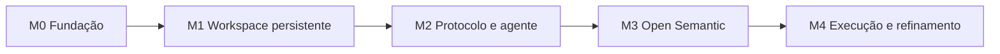

# Como começar a implementar o Open Semantic

Este guia transforma a [documentação por funcionalidade](funcionalidades/README.md) num caminho de construção. A ideia central: **construir de baixo para cima pelos contratos, mas entregar de ponta a ponta desde a primeira semana.** Cada marco termina com algo que se abre, se usa e se testa contra os critérios de aceitação da [V0.1](especificacao-v0.1.md#7-critérios-de-aceitação-da-v01).

## 1. Antes da primeira linha de código

Decisões tomadas por Arthur em 12/10:

1. **D1, D2 e D3 confirmados:** projeto local, Open Semantic como camada lógica, interação em lotes (ver [decisões](funcionalidades/README.md#decisões)).
2. **Forma do produto: confirmada como aplicativo desktop** (roda na máquina do usuário e abre uma pasta do disco). É o que torna o Explorer, o Editor e o Terminal reais sem infraestrutura de servidor.
3. **Stack:** Electron confirmado; o restante abaixo é a proposta que acompanha essa escolha.

### Stack

Critério: uma linguagem só de ponta a ponta, para que os tipos gerados dos schemas sejam os mesmos no runtime e na interface, e bibliotecas maduras para as partes difíceis (canvas, editor, terminal, layout).

| Parte | Proposta | Por quê | Alternativa |
|---|---|---|---|
| Linguagem | TypeScript | Mesmos tipos na interface e no runtime; gera tipos dos JSON Schemas | — |
| Casca do app | Electron (Tauri como alternativa mais leve) | Acesso ao disco e a processos locais | Web app + servidor local Node |
| Interface | React | Ecossistema das libs abaixo | Svelte, Solid |
| Canvas infinito | Canvas próprio em React (câmera, arrastar, redimensionar, enquadrar) | Sem dependência de licença comercial; a câmera e o enquadramento já são lógica nossa (`packages/navigator`). Decidido no M1 | tldraw (exige licença para uso comercial), React Flow (mais limitado como canvas geral) |
| Layout de diagramas | elkjs | Layout em camadas de qualidade, roda no navegador | dagre |
| Editor de texto | CodeMirror 6 | Leve, extensível, licença MIT. Decidido no M1 | Monaco (mais pesado) |
| Terminal | xterm.js + node-pty | Padrão de mercado | — |
| Observar arquivos | chokidar | Multiplataforma | fs.watch nativo |
| Validação | Ajv (JSON Schema 2020-12) | Valida com os mesmos schemas de `contracts/` | — |
| Tipos | json-schema-to-typescript | Tipos gerados, nunca escritos à mão | — |
| Persistência MVP | Um JSON por workspace (formato do snapshot) | Simples, inspecionável, igual ao schema | SQLite quando o volume pedir |
| IA | Modelo com uso de ferramentas (tool use) e uma ferramenta `run_batch` | O protocolo já é a ferramenta | — |

### Estrutura de repositório proposta

```
open-semantic/
  contracts/            ← schemas, exemplos e validador
  packages/
    protocol/           ← tipos gerados, Dispatcher, executor de lotes, idempotência, ActionRecord
    workspace-store/    ← snapshot, revisões, persistência, placement
    project-runtime/    ← fake em memória + implementação local
    semantic/           ← SemanticStore (memória) + regras de conhecimento
    diagram-engine/     ← apply_patch, layout
    navigator/          ← computeFrame, política de controle
    mod-runtime/        ← registro de tipos, ciclo de vida
    agent/              ← montagem de contexto, cliente do modelo, agente roteirizado
  apps/
    desktop/            ← casca Electron + interface React (canvas, mods, conversa)
  tests/acceptance/     ← um teste por critério A1…E5
```

Cada pacote corresponde a uma página em `funcionalidades/`. Pacotes de lógica (`protocol`, `semantic`, `diagram-engine`, `navigator`) não dependem de interface e são testados isoladamente.

## 2. Ordem de construção



Os marcos M1 a M4 são os quatro incrementos da V0.1 §8. M0 foi adicionado para que os contratos existam como código antes de qualquer tela.

### M0 · Fundação

- Repositório, lint, testes e CI.
- `contracts/` com schemas, exemplos e `validar.py` rodando no CI.
- Tipos TypeScript gerados dos schemas.
- Esqueleto do Dispatcher: registro de operações, validação com Ajv, `OperationResult`, erros estruturados.

**Pronto quando:** o CI valida os exemplos e um teste envia uma operação inválida e recebe `INVALID_ARGUMENTS` com `argumentPath` (critério E1).

### M1 · Workspace persistente (incremento 1 da V0.1)

**Primeira fatia de ponta a ponta (o alvo da primeira semana de trabalho):**

> Abrir uma pasta local → um Explorer aparece no canvas → clicar num arquivo abre um Editor ao lado → mover os dois → fechar o app → reabrir: tudo no mesmo lugar, mesmos ids.

Tarefas:
1. Workspace Store: snapshot em memória, revisões, salvar/abrir JSON. ([01](funcionalidades/01-workspace-e-canvas.md))
2. Canvas com pan, zoom e `CanvasObject` renderizados como formas customizadas.
3. Project Runtime falso (árvore em memória) e depois o local, só leitura: `resolve`, `list_dir`, `read_file`, `stat`. ([07](funcionalidades/07-project-runtime.md))
4. Mod Runtime com `explorer` e `editor`, ciclo `active`/`closed`. ([02](funcionalidades/02-mods.md))
5. Editor com buffer, indicador de não salvo e `editor.save` com fingerprint (escrita local, ação do usuário).
6. Enquadramento manual (“ajustar à tela”) com `computeFrame`. ([04](funcionalidades/04-semantic-navigator.md))

**Pronto quando:** passam A1, A2, A3, A4, A5, B1, B4 e o teste de ida e volta do snapshot.

### M2 · Conversa e protocolo de operações (incremento 2)

1. Executor de lotes: ordem topológica, `$bind`, `validateFirst`, `skip_dependents`, idempotência. ([06](funcionalidades/06-conversa-agente-e-protocolo.md))
2. Operações visuais registradas: `mod.*`, `region.*`, `canvas.*`, `diagram.create/apply_patch/layout`, `navigation.frame/cancel`.
3. **Agente roteirizado**: executa [`lote-referencia.json`](../contracts/exemplos/lote-referencia.json) e compara o estado final com [`workspace-apos-lote.json`](../contracts/exemplos/workspace-apos-lote.json). Isso prova o protocolo sem IA.
4. Diagram Engine com layout elkjs. ([03](funcionalidades/03-diagram-engine.md))
5. Navegação automática com `user_hold` e cancelamento.
6. Painel de conversa e ligação com o modelo de IA (ferramenta `run_batch` + leituras).
7. Confirmações: cartão na interface, token, reenvio.

**Pronto quando:** passam D1, D3, D4, D5, E1 a E5, e o pedido “crie o backend, abra o Explorer e mostre a arquitetura” funciona com a IA real.

### M3 · Open Semantic integrado (incremento 3)

1. `SemanticStore` em memória, persistida no snapshot; regras de conhecimento no runtime. ([05](funcionalidades/05-open-semantic.md))
2. `upsert_observation` / `upsert_inference` / `resolve` / `query` / `related` / `trace` / `invalidate`.
3. Vínculos nó ↔ entidade ↔ artefato; renderização por qualidade (tracejado para inferido).
4. `navigation.frame` por `semanticEntityIds`; `diagram.open_linked`.
5. Contexto do agente passa a incluir consultas semânticas.

**Pronto quando:** passam C1 a C4 e D2.

### M4 · Execução e refinamento (incremento 4)

1. Observador de arquivos, revalidação ao abrir, `stale`/`invalid` em cascata.
2. Conflito de edição externa no Editor.
3. Terminal com `commandPolicy`; Tabela.
4. Escrita, movimentação e exclusão pelo agente com confirmação; `undo` no histórico.
5. Suíte de aceitação completa A1…E5.

**Pronto quando:** todos os critérios da V0.1 passam na suíte de aceitação.

## 3. Como testar desde o início

| Nível | O que cobre | Exemplo |
|---|---|---|
| Contrato | Schemas e exemplos | `validar.py` e Ajv no CI |
| Unidade | Funções puras | `apply_patch`, `computeFrame`, ordenação do lote, regras de conhecimento |
| Integração | Dispatcher + módulos, sem interface | Agente roteirizado executando o lote de referência |
| Aceitação | Critérios A1…E5 | Um teste por critério, nomeado com o código (ex.: `E3_idempotencia_nao_duplica_mod`) |
| Com pessoas | Navegação automática | Ajustar `userHoldMs` e quando narrar movimentos |

Um runtime falso que falha de propósito deve existir desde M2, para provar que o agente nunca afirma sucesso de algo que falhou.

## 4. Riscos e como reduzir

| Risco | Mitigação |
|---|---|
| Canvas com muitos mods pesados (Monaco, xterm) fica lento | Estado `suspended` para mods fora da tela; renderizar só o visível |
| A IA gera planos inválidos com frequência | Validação prévia do lote devolve erros estruturados que o modelo corrige no mesmo turno |
| Navegação automática irrita o usuário | `user_hold`, `user_locked` e sugestões clicáveis em vez de movimento |
| Open Semantic vira cópia desatualizada do código | Evidências imutáveis + `stale` automático em mudança de arquivo |
| Segurança do terminal | `confirm_all` como padrão, comando exato no cartão |

## 5. Próximos passos sugeridos

1. Criamos o repositório com a estrutura acima e o M0. Para isso, o projeto precisa de um repositório GitHub conectado; posso criar a estrutura inicial assim que houver um.
2. Primeira fatia do M1 (Explorer + Editor persistentes) como primeiro pull request.
