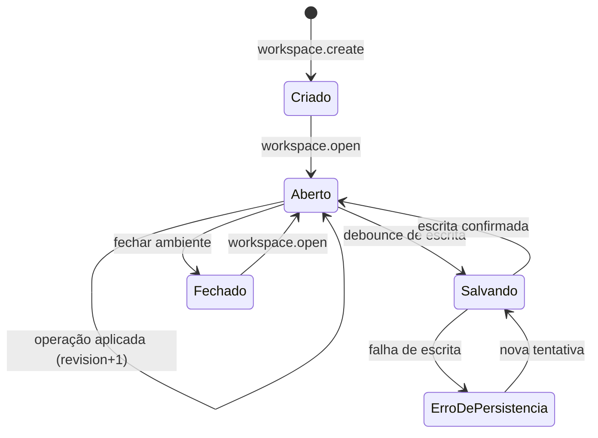

# 1. Workspace e Canvas

> Parte da documentação por funcionalidade do Open Semantic. Índice em [README.md](README.md). Contratos em [`contratos/schemas/workspace.schema.json`](../../contracts/schemas/workspace.schema.json).

## O que é

O workspace é o ambiente persistente onde todo o trabalho acontece. O canvas é a sua superfície visual: um plano infinito com zoom, onde mods e diagramas ocupam posições, e onde regiões nomeadas (Backend, Frontend, Testes…) organizam o espaço.

O workspace é também o **Workspace Store** da arquitetura lógica: ele guarda objetos, posições, regiões e preferências, e é a fonte de verdade para tudo que é *visual e espacial*. Ele não é fonte de verdade para arquivos (Project Runtime) nem para conhecimento (Open Semantic).

## Responsabilidades

- Criar, abrir e persistir workspaces, com um número de revisão que cresce a cada mudança.
- Guardar `CanvasObject` (posição, tamanho, z-index, região) para cada mod e diagrama.
- Guardar `Region` (área nomeada, opcionalmente ligada a entidades semânticas).
- Guardar preferências do workspace (navegação automática ligada/desligada, tempo de espera após interação do usuário, se o agente pode excluir mods).
- Calcular posicionamento quando um objeto é criado sem coordenadas (estratégia “espaço livre perto de X”).
- Restaurar tudo ao reabrir: mesmos ids, configurações, posições (critério A2).
- Publicar eventos de mudança para a interface e o agente.

## O que não faz

- Não lê nem escreve arquivos do projeto.
- Não decide o que um mod mostra; só onde ele está.
- Não anima a câmera (isso é o [Semantic Navigator](04-semantic-navigator.md)), embora persista o `NavigationState` como parte do snapshot.

## Modelo de dados

| Objeto | Schema | Persistido | Observação |
|---|---|---|---|
| Workspace | `workspace.schema.json#/$defs/Workspace` | Sim | `revision` global, `settings` |
| CanvasObject | `workspace.schema.json#/$defs/CanvasObject` | Sim | Mesmo id do mod ou diagrama que posiciona |
| Region | `workspace.schema.json#/$defs/Region` | Sim | `semanticEntityIds` permite “vá para o backend” |
| Snapshot completo | `workspace.schema.json` | Sim | Formato de exportação e de entrega ao agente |

### Onde cada coisa é gravada (decidido em 12/10)

O workspace é uma pasta escolhida pelo usuário na primeira abertura (padrão `~/Open Semantic`).

| O quê | Onde | Por quê |
|---|---|---|
| Referências aos projetos, canvas (posições, regiões), mods, câmera, configurações | `<workspace>/.open-semantic/workspace.json` | É a mesa de trabalho de cada pessoa |
| Histórico de ações | `<workspace>/.open-semantic/history.jsonl` | Idem |
| Repositórios clonados pela conversa | `<workspace>/repos/<nome>/` | O workspace guarda o que ele mesmo baixou |
| Diagramas de um repositório | `<repositório>/.open-semantic/diagrams/<id>.json` | Vai junto com o código: quem clona recebe o contexto |
| Entidades, relações e evidências de um repositório | `<repositório>/.open-semantic/knowledge.json` | Idem; arquivos citados pelo caminho relativo, não pelo id de artefato |

Regras da separação (`packages/workspace-store/src/repoStore.ts`): é do repositório P o diagrama de P, a entidade de P, a relação entre duas entidades de P e a evidência sobre um arquivo de P (ou sem arquivo e citada só por itens de P). O que liga projetos diferentes fica no workspace. Só vai para o repositório o que é de uma pasta local com permissão de escrita; pastas só de leitura guardam tudo no workspace. Ao abrir, o que está no repositório prevalece para os mesmos ids; um diagrama que não tem lugar no canvas ganha um em espaço livre. Tirar o projeto do workspace não apaga nada do repositório; excluir um diagrama apaga o arquivo dele.

Decisão de modelo: **o `CanvasObject` usa o mesmo id do objeto que posiciona** (como no exemplo da V0.1). Isso garante uma posição por objeto e simplifica referências. Se no futuro um mesmo mod precisar aparecer duas vezes, introduz-se um id de “vista”; por enquanto não.

Regra de concorrência: toda mudança persiste com `revision + 1` no objeto alterado e no workspace. Operações podem levar a pré-condição `revision_equals`; se outra mudança chegou antes, a resposta é `REVISION_CONFLICT` em vez de sobrescrever.

## Operações

| Operação | Argumentos principais | Saída | Idempotente | Confirmação |
|---|---|---|---|---|
| `workspace.create` | `workspaceId`, `name`, `projectIds` | snapshot inicial | Sim (por id) | Não |
| `workspace.open` | `workspaceId` | snapshot | Sim | Não |
| `workspace.add_project` | `projectId`, `name`, `rootPath` (absoluto ou `~/…`) | `projectId`, `rootId`, `rootArtifactId` | Sim (mesma pasta volta a ser a ativa) | Agente: sim |
| `workspace.clone_repository` | `projectId`, `url`, `name?` | idem + `path`, `cloned` | Sim (pasta já clonada é reaproveitada) | Agente: sim |
| `workspace.get_snapshot` | `include` (lista de seções), `regionId?` | snapshot filtrado | Sim (leitura) | Não |
| `canvas.place` | `objectId`, `position`, `size?` | retângulo final | Sim (mesmo destino) | Não |
| `canvas.arrange` | `objectIds`, `strategy` (`grid`, `row`, `column`), `regionId?` | retângulos finais | Sim | Não |
| `region.create` | `regionId`, `title`, `bounds?` ou `placement`, `semanticEntityIds?` | `bounds` final | Sim (por id) | Não |
| `region.update` | `regionId`, `set` | região | Sim | Não |
| `region.delete` | `regionId`, `keepObjects=true` | — | Sim | Sim se `keepObjects=false` |

Estratégias de `placement`: `{ "regionId": … }` (dentro da região, em espaço livre), `{ "strategy": "free_space_near", "anchorIds": [...] }` (perto dos âncoras sem sobrepor), ou coordenadas explícitas.

Regra de autonomia espacial: objetos com `placedBy: "user"` **não são movidos** por `canvas.arrange` do agente. O agente organiza o que ele mesmo colocou; o arranjo do usuário é preservado (visão §3.4).

## Estados

Ao reabrir (`Fechado → Aberto`): restaura objetos e regiões; zera `navigation.motion` para `idle`; marca todos os mods como `unloaded` no runtime; dispara revalidação de todas as `ArtifactReference` no [Project Runtime](07-project-runtime.md).

A interface deve mostrar quando há mudanças ainda não persistidas e quando a persistência falhou. O usuário precisa distinguir “salvo” de “pendente” de “falhou” (V0.1 §4.1).

## Eventos

Publica: `workspace.opened`, `workspace.revision_changed`, `canvas.object_moved`, `region.changed`.
Consome: `mod.created`/`mod.deleted` e `diagram.created`/`diagram.deleted` (para criar ou remover o `CanvasObject` correspondente na mesma transação lógica).

Cada `transact()` do store vira um **commit**: a lista do que mudou, por coleção, com o objeto antes e depois. Os objetos do store não mudam no lugar (ficam congelados; mudar é gravar uma cópia), então o commit guarda referências sem copiar, e um erro no meio da transação desfaz tudo antes de qualquer aviso. Dos commits saem:

- os eventos de domínio de todos os módulos (`workspace-store/src/events.ts`), com o `operationId` da operação em execução;
- a gravação automática;
- a cópia do workspace na interface, que aplica só o que mudou em vez de reler tudo (um commit perdido faz a interface reler).

A navegação é estado de visualização: mexer na câmera gera um commit só de visualização, que é salvo mas não muda `workspace.revision`. Assim, uma pré-condição `revision_equals` sobre o workspace não falha porque o usuário moveu a câmera.

## Critérios de aceitação

Da V0.1: A1, A2, A3, A5. Mais:

- Mover um objeto manualmente persiste a nova posição e marca `placedBy: "user"`.
- `canvas.arrange` do agente não move objetos com `placedBy: "user"`.
- Duas operações concorrentes com pré-condição na mesma revisão: uma vence, a outra recebe `REVISION_CONFLICT`.
- Exportar e reimportar o snapshot produz um workspace equivalente (mesmos ids, posições e referências), validado por [`contracts/validar.py`](../../contracts/validar.py).

## Como começar

1. Implementar o snapshot em memória com os tipos gerados a partir de `workspace.schema.json`.
2. Persistir como um único documento por workspace (arquivo JSON ou uma tabela de documentos). A V0.2 não exige banco; exige que o formato seja o do schema.
3. Implementar o canvas com pan, zoom e renderização de retângulos vazios para cada `CanvasObject` antes de qualquer mod real.
4. Teste de ida e volta: criar → mover → fechar → reabrir → comparar snapshot.

## Questões abertas

- Agrupamentos aninhados (região dentro de região) ficam para depois da V0.2.
- Colaboração em tempo real entre várias pessoas no mesmo workspace não está no escopo; o modelo de revisões não impede adicioná-la depois.
