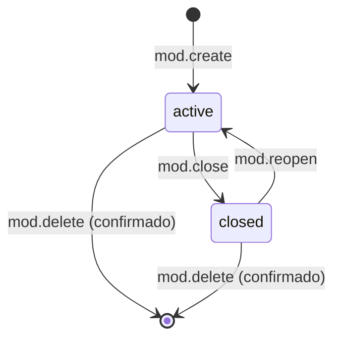
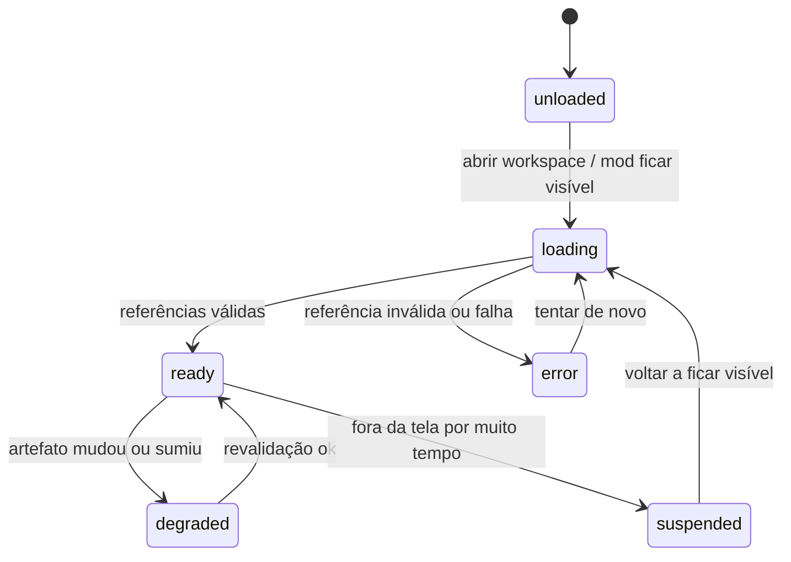
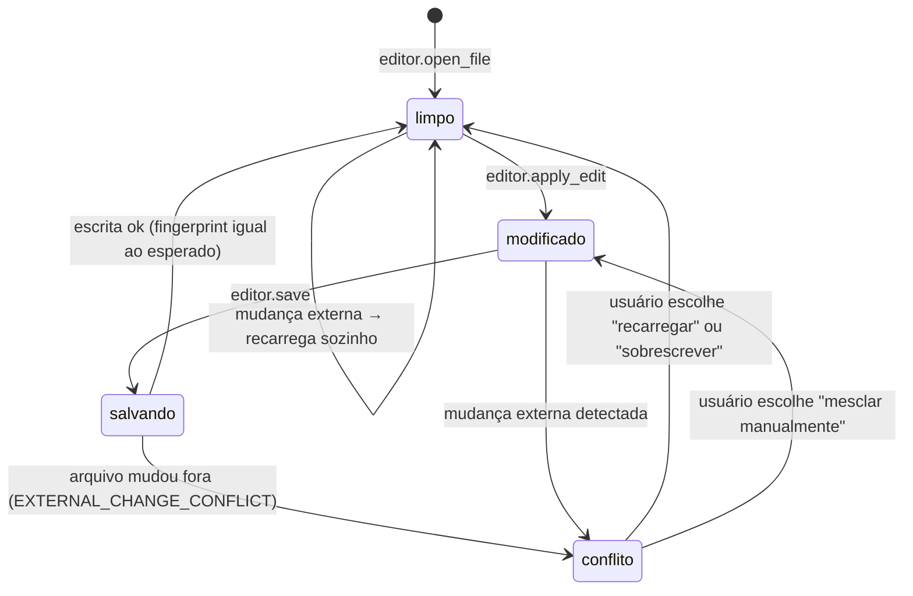

# 2. Mods (componentes funcionais) e Mod Runtime

> Parte da documentação por funcionalidade do Open Semantic. Índice em [README.md](README.md). Contratos em [`contratos/schemas/mod.schema.json`](../../contracts/schemas/mod.schema.json).

## O que é

Mods são as ferramentas que vivem no canvas: Explorer, Editor de texto, Terminal e Tabela na primeira versão. Não são desenhos; cada um tem configuração, estado e capacidades próprias, e opera sobre recursos reais por meio do [Project Runtime](07-project-runtime.md).

O **Mod Runtime** administra o catálogo de tipos e o ciclo de vida das instâncias.

## Responsabilidades

- Manter o catálogo de tipos (`ModTypeDescriptor`), cada um declarando versão, capacidades, schema de configuração e tamanho padrão.
- Criar, configurar, fechar, reabrir e excluir instâncias, validando a configuração contra o schema do tipo.
- Separar o que é persistido (identidade, configuração, estado de interface útil) do que não é (estado operacional e transitório), conforme V0.1 §2.4.
- Encaminhar chamadas de capacidade (`mod.invoke`) ao tipo certo, que por sua vez chama o Project Runtime.
- Informar erros operacionais de forma verificável (critério B5).

## O que não faz

- Não acessa o sistema de arquivos diretamente: um Explorer pede `project.list_dir`, não abre um diretório.
- Não decide posição no canvas (Workspace).
- Excluir um mod nunca apaga os arquivos associados (critério A4).

## Modelo de dados

| Camada | Onde fica | Persistido |
|---|---|---|
| Identidade (`id`, `type`, `typeVersion`) | `ModInstance` | Sim, estável |
| Configuração (`config`) | `ModInstance.config`, validada pelo schema do tipo | Sim |
| Estado de interface (`uiState`) | `ModInstance.uiState` | Sim, quando útil |
| Ligação semântica (`semanticEntityIds`) | `ModInstance` | Sim |
| Estado operacional (`status`, `dirty`, `conflict`, processo) | `ModRuntimeState` | **Não** |
| Estado transitório (hover, cursor, animação) | Só na interface | Não |

Configurações dos tipos iniciais (ver `$defs` no schema):

| Tipo | Configuração | Estado de interface |
|---|---|---|
| `explorer` | `rootRef` (diretório), `showHidden`, `exclude` | `currentDirRef`, `expanded`, `selected` |
| `editor` | `fileRef`, `readOnly`, `encoding` | (posição de rolagem, a definir) |
| `terminal` | `cwdRef`, `keepHistory` | — |
| `table` | `source` (inline, arquivo CSV/JSON ou resultado de operação), `columns`, `editable` | — |

Navegar de uma pasta para outra no Explorer muda `uiState.currentDirRef`; o id do mod não muda (V0.1 §2.1).

## Operações

| Operação | Argumentos | Saída | Idempotente | Confirmação |
|---|---|---|---|---|
| `mod.list_types` | — | `ModTypeDescriptor[]` | Sim | Não |
| `mod.create` | `modId`, `type`, `config`, `title?`, `semanticEntityIds?`, `placement` | `modId`, retângulo | Sim (por `modId`) | Não |
| `mod.configure` | `modId`, `config` (parcial, merge) | nova revisão | Sim | Não |
| `mod.focus` | `modId` | — (delegado ao Navigator) | Sim | Não |
| `mod.close` | `modId` | lifecycle `closed` | Sim | Se houver alterações não salvas |
| `mod.reopen` | `modId` | lifecycle `active` | Sim | Não |
| `mod.delete` | `modId` | — | Sim (excluir de novo = `unchanged`) | Sempre para o agente, salvo `settings.agentMayDeleteMods` |
| `mod.invoke` | `modId`, `capability`, `input` | saída da capacidade | Conforme a capacidade | Conforme a capacidade |

Capacidades iniciais por tipo (expostas via `mod.invoke`):

| Tipo | Capacidade | Exige | Idempotente | Confirmação |
|---|---|---|---|---|
| explorer | `explorer.navigate` (muda pasta atual) | read | Sim | Nunca |
| explorer | `explorer.reveal` (expande e seleciona um artefato) | read | Sim | Nunca |
| editor | `editor.open_file` | read | Sim | Nunca |
| editor | `editor.apply_edit` (altera o buffer) | — | Não | Nunca (só buffer) |
| editor | `editor.save` | write | Sim (mesmo conteúdo) | Política (agente: sim) |
| editor | `editor.reload` (descarta buffer) | read | Sim | Se `dirty` |
| terminal | `terminal.run` | execute | **Não** | Política de comandos |
| terminal | `terminal.kill` | execute | Sim | Não |
| table | `table.sort`, `table.filter` | — | Sim | Nunca |
| table | `table.edit_cell` + `table.save` | write (se fonte for arquivo) | Não / Sim | Política |

O agente não deve presumir que todo mod suporta toda operação: chamar uma capacidade que o tipo não declara retorna `CAPABILITY_NOT_SUPPORTED`.

## Estados

Ciclo de vida persistido:

`closed` mantém o objeto no canvas (recolhido) com configuração e posição; só libera recursos de runtime (ex.: encerra o processo do terminal, depois de confirmar).

Estado operacional (não persistido):

Estados do buffer do Editor:

O Editor sempre salva com a pré-condição `artifact_unchanged` usando o fingerprint lido na abertura. É isso que impede a sobrescrita silenciosa (V0.1 §4.1 regra 4).

## Eventos

Publica: `mod.created`, `mod.configured`, `mod.lifecycle_changed`, `mod.deleted`, `mod.runtime_state_changed`, `editor.conflict_detected`.
Consome: `artifact.changed`, `artifact.missing`, `artifact.validity_changed` (para passar a `degraded` ou recarregar), `process.output`, `process.exited` (Terminal).

## Critérios de aceitação

Da V0.1: A3, A4, B1 a B5. Mais:

- `mod.create` repetido com o mesmo `modId` e mesma configuração devolve o resultado original com `replayed: true` e não cria um segundo mod (critério E3).
- `mod.create` repetido com o mesmo `modId` e configuração diferente devolve `IDEMPOTENCY_MISMATCH`.
- Um Editor aberto num arquivo alterado externamente com buffer modificado mostra o conflito e não salva sem decisão do usuário.
- Uma configuração que não valida no schema do tipo é rejeitada com `INVALID_ARGUMENTS` e `argumentPath`.

## Como começar

1. Registro de tipos com dois tipos: `explorer` e `editor` (o incremento 1 da V0.1).
2. Contrato de componente na interface: cada tipo recebe `{ instance, runtimeState, invoke }` e nunca chama o sistema de arquivos.
3. Explorer lendo de um Project Runtime falso (árvore em memória), depois do real.
4. Editor com buffer, indicador de não salvo e salvamento com fingerprint.
5. Terminal e Tabela entram no incremento 4, depois que permissões e política de comandos existirem.

## Questões abertas

- Mods de terceiros (plugins) ficam fora do MVP; o prefixo `x-` no tipo reserva espaço para eles.
- Se o Terminal deve manter o processo vivo com o mod `closed` (hoje: não, encerra após confirmação).
