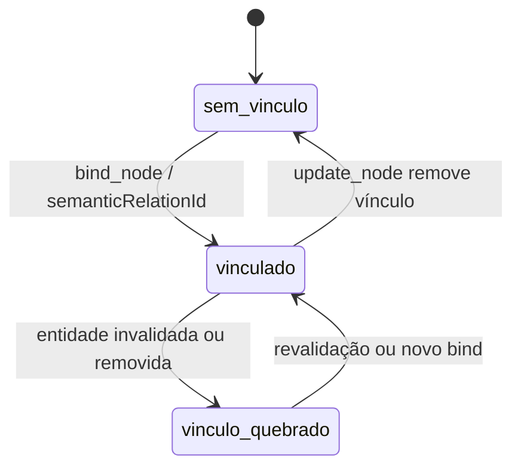

# 3. Diagram Engine

> Parte da documentação por funcionalidade do Open Semantic. Índice em [README.md](README.md). Contratos em [`contratos/schemas/diagram.schema.json`](../../contracts/schemas/diagram.schema.json).

## O que é

O motor de diagramas cria e mantém diagramas estruturados: nós, arestas, tipos e propriedades, com vínculos opcionais a entidades e relações do [Open Semantic](05-open-semantic.md). Diagramas não são imagens geradas pela IA; são modelos editáveis pelo agente e pelo usuário.

## Responsabilidades

- Criar diagramas a partir de um modelo tipado.
- Aplicar patches (adicionar, atualizar, remover nós e arestas; vincular nó a entidade).
- Validar referências: aresta aponta para nós do mesmo diagrama; vínculos semânticos existem.
- Calcular layout automático e respeitar nós fixados pelo usuário.
- Devolver exatamente as alterações aplicadas.
- Mostrar, em cada nó e aresta, a qualidade do conhecimento vinculado (verificado, inferido, desatualizado).

## O que não faz

- **Mover um nó não altera nada no Open Semantic nem no projeto real.** O layout é uma propriedade separada do modelo (V0.1 §3.3).
- Não cria entidades semânticas sozinho. Se o agente quer que um nó represente algo novo, ele cria a entidade no Open Semantic (como observação ou inferência) e então vincula.
- Não infere relações a partir do desenho.

## Modelo de dados

- `DiagramModel`: `id`, `title`, `kind` (`architecture`, `flow`, `sequence`, `dependency`, `freeform`), `nodes`, `edges`, `layout`, `revision`.
- `DiagramNode`: `label`, `kind`, `semanticEntityId?`, `parentNodeId?` (agrupamento), `attributes`.
- `DiagramEdge`: `sourceNodeId`, `targetNodeId`, `label`, `kind`, `semanticRelationId?`.
- `DiagramLayout`: `algorithm`, `direction`, retângulo de cada nó, lista `pinned`.

O estado visual de qualidade (cor, borda tracejada para “inferido”, ícone de alerta para “desatualizado”) **não é persistido no diagrama**; é derivado do `status` da entidade ou relação vinculada no momento de renderizar. Assim, quando o Open Semantic muda o status, o diagrama reflete sem precisar ser reescrito.

Dois diagramas podem ter nós vinculados à mesma entidade. É assim que um arquivo aparece em vários diagramas sem duplicar identidade (critério C2).

## Operações

| Operação | Argumentos | Saída | Idempotente | Confirmação |
|---|---|---|---|---|
| `diagram.create` | `diagramId`, `title`, `kind`, `nodes`, `edges`, `layout` (algoritmo), `placement` | ids criados | Sim (por id) | Não |
| `diagram.get` | `diagramId` | modelo + status semânticos resolvidos | Sim | Não |
| `diagram.apply_patch` | `diagramId`, `DiagramPatch` (`ops`, `relayout`) | alterações aplicadas | Sim (ids escolhidos pelo cliente) | Não |
| `diagram.layout` | `diagramId`, `algorithm`, `direction?`, `respectPinned=true` | novo layout | Sim | Não |
| `diagram.delete` | `diagramId` | — | Sim | Sempre para o agente |
| `diagram.move_node` | `diagramId`, `nodeId`, `position` | posição | Sim | Não |
| `diagram.open_linked` | `nodeId`, `as` (`explorer`/`editor`) | `modId` aberto ou focado | Sim | Não |

`diagram.apply_patch` é atômico **dentro do diagrama**: ou todas as ops do patch valem, ou nenhuma. Erros apontam o índice da op (`argumentPath: "/ops/3"`).

`diagram.open_linked` resolve o nó → entidade → artefato e abre (ou foca, se já existe) o mod adequado. Isso cobre o critério D2.

## Estados

O diagrama em si só tem `existe` / `excluído`, com `revision` crescente. O estado interessante é o de cada vínculo:

Um nó com vínculo quebrado continua no diagrama, sinalizado; não some sozinho.

## Eventos

Publica: `diagram.created`, `diagram.changed`, `diagram.deleted`.
Consome: `semantic.status_changed`, `semantic.entity_upserted` (re-renderizar qualidade e rótulos), `navigation.*` (destaques).

## Critérios de aceitação

Da V0.1: D1, D2, D5, C2. Mais:

- Arrastar um nó muda só `layout.nodes[...]` e o adiciona a `pinned`; nenhuma entidade ou relação muda de revisão.
- Um relayout automático não move nós fixados.
- Uma aresta vinculada a uma relação `inferred` é renderizada de forma distinta de uma `verified`.
- Patch com uma op inválida não aplica nenhuma op.

## Como começar

1. Renderizar um `DiagramModel` com layout manual (posições do schema) dentro do retângulo do `CanvasObject`.
2. Implementar `apply_patch` puro (função que recebe modelo e patch e devolve novo modelo ou erro), com testes de unidade.
3. Integrar um algoritmo de layout em camadas (há bibliotecas maduras para isso; a escolha entra junto com a stack).
4. Vínculos semânticos e estilo de qualidade entram no incremento 3.

## Questões abertas

- Diagramas de sequência têm semântica de ordem que o modelo atual de nós e arestas não expressa bem; pode precisar de um `kind` com estrutura própria mais tarde.
- Importar/exportar Mermaid ou outro formato textual é útil, mas não é requisito da V0.1.
