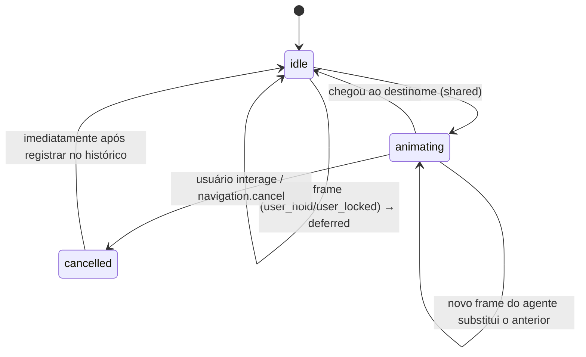
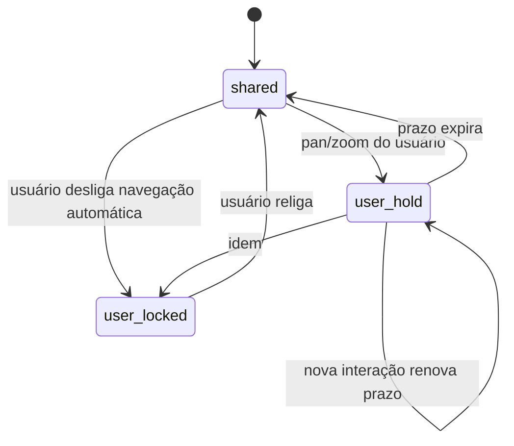

# 4. Semantic Navigator (câmera, foco e navegação automática)

> Parte da documentação por funcionalidade do Open Semantic. Índice em [README.md](README.md). Contratos em [`contratos/schemas/navigation.schema.json`](../../contracts/schemas/navigation.schema.json).

## O que é

O Semantic Navigator conduz a atenção do usuário no canvas. O agente diz **o que** deve ser visto (“enquadre o fluxo entre frontend e backend”); o Navigator resolve **quais objetos** isso significa, calcula a geometria e anima a câmera. A V0.1 definiu a navegação automática como requisito funcional, então suas regras são parte do contrato.

## Responsabilidades

- Resolver alvos: ids visuais, entidades semânticas (→ nós de diagrama e mods vinculados) ou uma região.
- Calcular enquadramento (caixa que contém os alvos + margem, zoom limitado).
- Animar a câmera, com possibilidade de cancelamento a qualquer instante.
- Destacar elementos sem alterar seus dados.
- Manter histórico curto, última visão geral e ponto de retorno.
- Arbitrar o controle entre agente e usuário.

## O que não faz

- Não cria entidades, mods ou diagramas e não altera arquivos (critério D5).
- Não inventa destino: se nada resolve, devolve erro estruturado e o agente pede esclarecimento ou mostra a visão geral.

## Modelo de dados

`NavigationState` (persistido como estado recuperável). É estado de visualização: mudá-lo não altera a revisão do documento (ver [Workspace e canvas](01-workspace-e-canvas.md#eventos)).

| Campo | Significado |
|---|---|
| `camera` | `center` + `zoom` atuais |
| `focus` | região em foco, alvos enquadrados, alvos destacados |
| `lastOverview` | última câmera de visão geral, para “voltar ao todo” |
| `history` | até 20 entradas `{camera, focus, origin, at}` |
| `motion` | `idle` / `animating` / `cancelled`, origem e alvo do movimento (volta a `idle` ao reabrir) |
| `control.mode` | `shared`, `user_hold` (usuário mexeu há pouco), `user_locked` (navegação automática desligada) |

## Operações

| Operação | Argumentos | Saída | Idempotente | Confirmação |
|---|---|---|---|---|
| `navigation.frame` | `FrameRequest`: `targets` (`visualIds` / `semanticEntityIds` / `regionId`), `intent` (`overview`, `focus`, `detail`, `compare`), `highlight`, `padding`, `animate`, `reason` | `navigationId`, câmera final, `framedIds`, `deferred?` | Sim | Não |
| `navigation.highlight` | `targetIds`, `durationMs?` | — | Sim | Não |
| `navigation.zoom` | `factor` ou `level`, `anchor?` | câmera | Sim | Não |
| `navigation.back` | — | câmera restaurada do histórico | Não | Não |
| `navigation.overview` | — | câmera de visão geral | Sim | Não |
| `navigation.cancel` | `navigationId?` | estado `cancelled` | Sim | Não |
| `navigation.set_control` | `mode` | — | Sim | Só o usuário pode pôr/tirar `user_locked` |

`mod.focus` é açúcar para `navigation.frame` com um único alvo.

Resolução de `semanticEntityIds`: para cada entidade, coleta nós de diagrama vinculados, mods com a entidade em `semanticEntityIds` e regiões ligadas a ela. Se a coleta vier vazia, o resultado é `rejected` com `TARGET_NOT_FOUND` e `details.unresolved` listando as entidades.

## Política de navegação (contrato de comportamento)

Tradução da tabela da V0.1 §5.1 em regras executáveis:

| Situação | Regra |
|---|---|
| Novo assunto sem objetos | O agente cria os objetos (no mesmo lote) e termina com `navigation.frame` neles. |
| Continuação do assunto | O agente não envia `frame` se os alvos já estão visíveis (o Navigator devolve `unchanged` se mesmo assim receber). |
| Outra área do projeto | `frame` com `regionId` ou entidades da área. |
| Vários componentes | `frame` com `intent: "compare"`, todos os alvos de uma vez. |
| Exploração profunda | `intent: "detail"`; antes de aproximar, a câmera atual vai para `lastOverview` se for mais aberta. |
| Usuário mexe na câmera | Qualquer pan/zoom do usuário cancela o movimento em curso e põe `control.mode = user_hold` por `settings.userHoldMs` (padrão 4 s). |
| Pedido do agente durante `user_hold` | Não move. Resultado `succeeded` com `deferred: true`; a interface mostra uma sugestão clicável (“Ver arquitetura”). |
| `user_locked` | Igual a `user_hold`, sem prazo. |
| Usuário interrompe | Esc, clique ou toque cancela; evento `navigation.cancelled` com `origin: "user"`. |
| Contexto insuficiente | `TARGET_NOT_FOUND`; nunca um destino aproximado silencioso. |

## Estados

Controle:

## Eventos

Publica: `navigation.started`, `navigation.completed`, `navigation.cancelled`, `navigation.user_interacted`.
Consome: `canvas.object_moved`, `diagram.changed` (alvos mudaram de lugar durante a animação → recalcula destino).

## Critérios de aceitação

Da V0.1: A5, D3, D4, D5. Mais:

- Um `frame` com alvos fora da área visível termina com todos eles dentro da viewport.
- Pan do usuário durante uma animação a cancela em menos de um quadro e nenhum novo movimento automático acontece pelos próximos `userHoldMs`.
- `frame` em entidade sem representação visual devolve `TARGET_NOT_FOUND`.
- Nenhuma operação de navegação altera a revisão do documento (`workspace.revision`) nem a de mods, diagramas ou entidades.

## Como começar

1. Câmera com pan e zoom manuais (faz parte do incremento 1).
2. Função pura `computeFrame(rects, viewport, padding, intent) → camera`, com testes.
3. Animação cancelável e o mecanismo `user_hold`.
4. Resolução por `semanticEntityIds` entra quando o Open Semantic existir (incremento 3); antes disso, só `visualIds` e `regionId`.

## Questões abertas

- Valor padrão de `userHoldMs` (proposto 4 s) precisa ser ajustado em teste com pessoas.
- Se o agente deve narrar a navegação (texto curto em `reason`) sempre ou só quando a mudança é grande.
