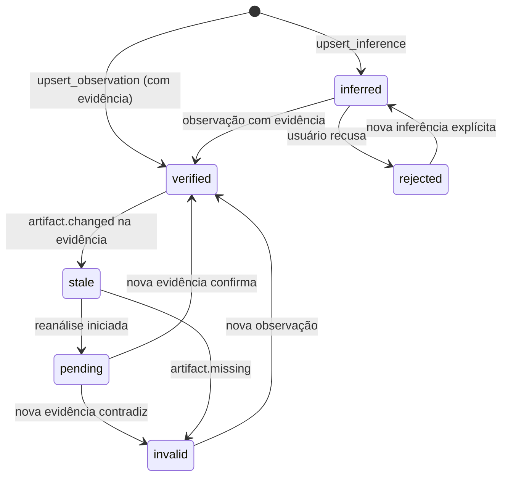

# 5. Open Semantic (modelo semântico integrado)

> Parte da documentação por funcionalidade do Open Semantic. Índice em [README.md](README.md). Contratos em [`contratos/schemas/semantic.schema.json`](../../contracts/schemas/semantic.schema.json).

## O que é

A camada que dá coerência ao ambiente: registra **quais entidades existem** (módulos, serviços, APIs, arquivos, decisões), **como se relacionam**, **onde estão representadas** e **quais evidências sustentam cada afirmação**. É o que permite à IA trabalhar com contexto estruturado e verificável, e não só com as mensagens recentes.

Decisão D2 (confirmada por Arthur em 12/10): **o Open Semantic é uma camada lógica** atrás de uma interface `SemanticStore`. O schema descreve o modelo lógico; o armazenamento é plugável (no MVP, o mesmo documento do workspace; depois, um banco de grafos ou relacional, sem mudar os contratos).

## Responsabilidades

- Guardar entidades, relações e evidências com procedência explícita.
- Garantir a regra central: **inferência do agente nunca vira fato verificado sem evidência** (validado no schema por `KnowledgeRules`).
- Resolver referências textuais ou ids para entidades (`semantic.resolve`).
- Responder consultas e vizinhança (`semantic.query`, `semantic.related`).
- Invalidar conhecimento quando os artefatos mudam e explicar de onde veio cada relação (`semantic.trace`).

## O que não faz

- Não lê arquivos. Quem observa é o agente (via Project Runtime) ou um indexador; o Open Semantic registra a observação.
- Não decide layout nem visual.
- Não “corrige” sozinho uma relação inferida; só muda seu status com base em evidência ou decisão do usuário.

## Os quatro conceitos que não se confundem

| Conceito | Exemplo | Onde vive |
|---|---|---|
| Entidade semântica | “Serviço de autenticação” (`sem_auth`) | Open Semantic |
| Objeto visual | Nó `nd_auth` no diagrama, Explorer `mod_auth` | Diagram Engine, Mods, Workspace |
| Recurso real | `backend/src/auth/` (`art_auth_dir`) | Project Runtime (`ArtifactReference`) |
| Estado de navegação | Câmera enquadrando `nd_auth` | Navigator |

Ligações: objeto visual → entidade (`semanticEntityId`); entidade → recurso (`artifactIds`). Um arquivo é uma entidade `kind: "file"` com um único `artifactId`; assim Explorer, Editor e diagrama apontam para a mesma identidade (critério C2).

## Qualidade do conhecimento

| Status | Significado | Como se chega |
|---|---|---|
| `verified` | Confirmado por inspeção, execução ou afirmação do usuário, com ≥ 1 evidência | `upsert_observation` |
| `inferred` | Hipótese do agente, com `confidence` e `rationale` | `upsert_inference` |
| `pending` | Recalculando (atualização eventual controlada) | Artefato mudou e há reanálise em curso |
| `stale` | Evidência ficou desatualizada | Artefato mudou; ninguém reanalisou ainda |
| `invalid` | Evidência contradita ou artefato sumiu | Revalidação falhou |
| `rejected` | Usuário recusou a inferência | Decisão do usuário |

Evidências são imutáveis. Quando o arquivo muda, a evidência passa a `stale` e as entidades/relações que dependem dela seguem o diagrama acima; nada é reescrito em silêncio.

## Operações

| Operação | Argumentos | Saída | Idempotente | Confirmação |
|---|---|---|---|---|
| `semantic.resolve` | `ref` (id, caminho, nome ou alias), `kindHint?` | entidade ou candidatos com score | Sim | Não |
| `semantic.query` | `kinds?`, `text?`, `status?`, `projectId?`, `limit` | entidades | Sim | Não |
| `semantic.related` | `entityId`, `relationTypes?`, `direction`, `depth≤3` | subgrafo | Sim | Não |
| `semantic.upsert_observation` | `entity?` e/ou `relation?`, `evidence` (obrigatória) | ids e status `verified` | Sim (por ids) | Não |
| `semantic.upsert_inference` | `entities?`, `relations?`, `confidence`, `rationale` | ids e status `inferred` | Sim (por ids) | Não |
| `semantic.set_status` | `id`, `status` (`rejected`/`inferred`), `reason` | — | Sim | Só o usuário pode `rejected` |
| `semantic.invalidate` | `artifactId` ou `ids`, `reason` | ids afetados | Sim | Não |
| `semantic.trace` | `id` | cadeia de procedência e evidências | Sim | Não |

Regra de promoção: `upsert_observation` sobre uma relação existente `inferred` a promove a `verified` e preserva a inferência original no histórico de procedência. `upsert_inference` sobre algo `verified` **não rebaixa**; é rejeitado com `PRECONDITION_FAILED`.

## Eventos

Publica: `semantic.entity_upserted`, `semantic.relation_upserted`, `semantic.status_changed`.
Consome: `artifact.changed`, `artifact.missing` (dispara `stale`/`invalid` nas evidências e no que depende delas).

## Critérios de aceitação

Da V0.1: C1 a C4. Mais:

- Tentar gravar `status: "verified"` com `source: "agent_inference"` falha na validação (coberto pelo teste negativo em `contracts/validar.py`).
- Alterar externamente um arquivo citado por uma evidência deixa a relação dependente `stale` em até um ciclo de observação.
- `semantic.trace` de uma relação verificada lista a evidência, o arquivo e a operação que a criou.

## Como começar

1. Interface `SemanticStore` com implementação em memória e persistência no snapshot do workspace.
2. Validação de `KnowledgeRules` no runtime (não só no schema).
3. Primeiro “indexador” mínimo: ao criar um Explorer, registrar o diretório como entidade `directory` verificada por `directory_listing`.
4. Inferências do agente entram com a conversa (incremento 2) já no formato `upsert_inference`, mesmo antes da camada completa do incremento 3.

## Questões abertas

- D2 (camada lógica vs. grafo persistido) — ver [README](README.md#decisões).
- Extração automática de relações a partir de código (imports, rotas HTTP) é desejável; não está no MVP e exigiria análise por linguagem.
- Vocabulário de `kind` e `type` precisa estabilizar com uso; extensões usam prefixo `x-`.
