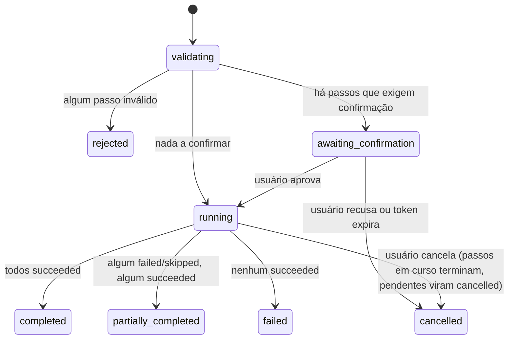
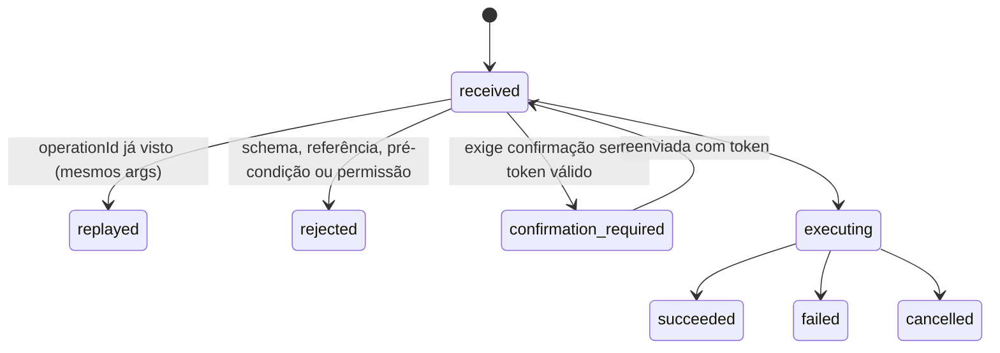

# 6. Conversa, Agent Orchestrator e protocolo de operações

> Parte da documentação por funcionalidade do Open Semantic. Índice em [README.md](README.md). Contratos em [`contratos/schemas/operation.schema.json`](../../contracts/schemas/operation.schema.json). Exemplos em [`contratos/exemplos/`](../../contracts/exemplos/).

## O que é

A conversa é a interface de intenção. O **Agent Orchestrator** transforma cada mensagem em um plano de operações tipadas, envia o plano ao runtime, observa os resultados reais e responde ao usuário. O **protocolo de operações** é a linguagem comum entre o agente e todos os módulos.

Regra arquitetural (V0.1 §1): o agente nunca toca o estado da interface ou o sistema de arquivos. Ele só pede operações; os módulos validam e executam.

## Responsabilidades

**Interface conversacional:** histórico de mensagens (cada uma com `turnId`), exibição do plano em execução e dos resultados, cartões de confirmação, links de mensagens para objetos do canvas.

**Agent Orchestrator:**
- Montar o contexto do modelo de IA: snapshot filtrado do workspace (`workspace.get_snapshot`), resultados de `semantic.query`/`related`, catálogo de operações e de tipos de mod.
- Expor o catálogo de operações ao modelo como ferramentas (uma ferramenta “executar lote” é suficiente; ver abaixo).
- Gerar `operationId` e ids de objetos novos (para idempotência).
- Enviar lotes, tratar confirmações, repetir com segurança em falhas de rede.
- Responder com base nos resultados efetivos, nunca no que pretendia fazer (V0.1 §6: “sem simular sucesso”).

**Operation Dispatcher** (parte do runtime, não do agente):
- Validar requisições contra os schemas, resolver `$bind`, checar pré-condições e autorização.
- Encaminhar ao módulo dono da operação (pelo prefixo: `mod.*` → Mod Runtime, `project.*` → Project Runtime…).
- Registrar `ActionRecord` e publicar eventos.
- Garantir idempotência por `operationId`.

## Contrato comum de operação

`OperationRequest`: `operationId`, `operation`, `targetId?`, `arguments`, `preconditions[]`, `authorization` (`actor`, `onBehalfOf`, `confirmationToken?`), `dryRun`, `turnId`, `batchId`/`stepId`.

`OperationResult`: `status` ∈ `succeeded` | `rejected` | `failed` | `confirmation_required` | `cancelled` | `skipped`; `output`; `changes[]` (id + created/updated/deleted/unchanged + revisão); `error` estruturado; `confirmation` (token, risco, resumo, expiração); `replayed`; `workspaceRevision`.

Diferença importante: **`rejected`** = falhou na validação, nada mudou. **`failed`** = começou a executar e falhou; `changes` diz o que chegou a mudar.

### Idempotência

- O `operationId` é a chave. O Dispatcher guarda `(operationId → hash dos argumentos, resultado)`.
- Mesmo id + mesmos argumentos → devolve o resultado guardado com `replayed: true`, sem executar de novo.
- Mesmo id + argumentos diferentes → `IDEMPOTENCY_MISMATCH`.
- Leituras (snapshot, query, list_dir, read_file) guardam só o hash dos argumentos: o reenvio consulta de novo, e o conteúdo lido não fica na memória.
- O Dispatcher guarda os 1.000 resultados mais recentes; reenvios acontecem logo depois do original.
- Operações de criação recebem o id do objeto do cliente (`modId`, `diagramId`…), então mesmo um id de operação novo não duplica o objeto: cria → `created`; repete com mesmo conteúdo → `unchanged`.
- Operações naturalmente não idempotentes (`terminal.run`, `editor.apply_edit`, `navigation.back`) só são protegidas pela chave `operationId`.

### Autorização e confirmação

| Classe de operação | Usuário | Agente |
|---|---|---|
| Leitura (snapshot, query, list_dir, read_file) | Livre | Livre, dentro das raízes |
| Trazer uma pasta local ou clonar um repositório para o workspace | Livre | Confirmação; o cartão diz que diagramas e conhecimento ficarão em `.open-semantic/` dentro dele |
| Visual (criar mod, diagrama, região, navegar, organizar) | Livre | Livre (navegação automática confirmada na V0.1) |
| Excluir mod, diagrama ou região com objetos | Livre | Confirmação, salvo `agentMayDeleteMods` |
| Escrever arquivo / criar diretório | Livre | Criar diretório: livre. Escrever conteúdo: confirmação (pode ser em lote, `upfront`) |
| Excluir arquivo | Confirmação | Confirmação, risco `irreversible` se sem lixeira |
| Executar comando | Conforme `commandPolicy` | Conforme `commandPolicy` (padrão: confirmar tudo) |

Fluxo: o runtime responde `confirmation_required` com `token` e `summary`; a interface mostra o cartão; ao aprovar, a mesma requisição é reenviada com `authorization.confirmationToken`. Tokens expiram e valem para uma requisição específica (hash dos argumentos). Isso cobre o critério E5.

Quem pode o quê fica no próprio handler, no catálogo de operações (`packages/protocol/src/catalog.ts`):

- `readOnly` marca as consultas;
- `actors` diz quem pode chamar (só o usuário escolhe o projeto ativo, tira uma pasta do workspace ou liga a navegação automática). Os outros são recusados com `UNAUTHORIZED` antes de qualquer validação dos argumentos;
- `agent` abre a operação ao agente, com a linha dela no prompt (`guide`), a frase do passo no cartão do lote (`describe`) e, quando precisa, o pedido de confirmação (`confirm`).

A política do app (`catalogPolicy`) sai daí: o usuário age livremente; o agente consulta livremente e só muda o que tem `agent`. Qualquer outra mudança é recusada com `UNAUTHORIZED`, inclusive dentro de um lote. A lista de operações das ferramentas do modelo e a seção de operações do prompt saem do mesmo catálogo (`Dispatcher.agentOperations`); o resto do prompt é escrito à mão. Uma operação nova pede só o handler (com o schema e esses campos) e o teste; um domínio novo também entra em `OperationName` (`operation.schema.json`).

## Lotes com dependências (decisão D3, confirmada em 12/10)

O agente envia um **`BatchPlan`**, um DAG de passos.

- `dependsOn` declara a ordem; passos independentes podem rodar em paralelo.
- `{"$bind": {"step": "mk_backend", "pointer": "/output/artifacts/0/id"}}` injeta a saída de um passo anterior. Só pode apontar para um passo do qual se depende (verificado por `validar.py`).
- `policy.validateFirst` (padrão sim): antes de executar qualquer coisa, valida todos os passos que não têm `$bind` pendente. Erros de forma aparecem antes de efeitos.
- `policy.confirmation: "upfront"` (padrão): todas as confirmações do lote são pedidas num único cartão antes de começar.
- `policy.onStepFailure`: `skip_dependents` (padrão; passos que dependem do que falhou viram `skipped` com `DEPENDENCY_FAILED`) ou `abort_batch`.
- Não há transação global. O resultado diz exatamente o que aconteceu em cada passo (`BatchResult.status`: `completed`, `partially_completed`, `failed`…). Passos visuais concluídos podem ser desfeitos pelo `undo` do `ActionRecord`.

### Estados do lote

### Estados de uma operação

## Fluxo completo de referência

Pedido: **“Crie o backend, abra o Explorer e mostre a arquitetura.”** Arquivos: [`lote-referencia.json`](../../contracts/exemplos/lote-referencia.json) (plano), [`lote-resultado.json`](../../contracts/exemplos/lote-resultado.json) (resultado), [`workspace-apos-lote.json`](../../contracts/exemplos/workspace-apos-lote.json) (estado final).

1. **Contexto.** O Orchestrator chama `workspace.get_snapshot` e `semantic.query {text: "backend"}`. Não há entidade nem diretório `backend`.
2. **Plano.** O modelo devolve um lote de 7 passos:
   - `mk_backend` → `project.create_dir backend` (escrita leve, sem confirmação).
   - `sem_backend` (depende de `mk_backend`) → `semantic.upsert_observation`: entidade `Backend` **verificada**, com evidência `directory_listing` do diretório recém-criado.
   - `infer_arch` (depende de `sem_backend`) → `semantic.upsert_inference`: entidade `Frontend` e relação `Frontend communicates_with Backend`, **inferidas**, confiança 0,7, com justificativa.
   - `region` → região “Backend” ligada a `sem_backend`.
   - `explorer` (depende de `mk_backend`, `region`) → `mod.create explorer` com `rootRef` vindo de `$bind`.
   - `diagram` (depende de `infer_arch`, `region`) → diagrama de arquitetura com dois nós vinculados às entidades e uma aresta vinculada à relação inferida.
   - `frame` (depende de `explorer`, `diagram`) → `navigation.frame` com `intent: "compare"`.
3. **Validação.** O Dispatcher valida os passos sem `$bind` (`infer_arch`, `region`, `diagram`, `frame`, `mk_backend`); nenhum precisa de confirmação.
4. **Execução.** Ordem topológica; `mk_backend` devolve `art_backend_dir`; os `$bind` são resolvidos e os passos dependentes validados no momento.
5. **Eventos.** A interface recebe `artifact.created`, `semantic.*`, `region.changed`, `mod.created`, `diagram.created`, `navigation.started/completed` e redesenha. A aresta Frontend→Backend aparece tracejada (inferida).
6. **Resposta.** O agente responde com base no `BatchResult`: “Criei a pasta backend/, abri um Explorer nela e montei a arquitetura. A comunicação Frontend→Backend por HTTP ainda é uma suposição minha; vira confirmada quando houver código que a implemente.”
7. **Histórico.** Sete `ActionRecord`s com `batchId` e `turnId`; cada mudança no snapshot tem `operationId` na procedência (critério E4).

Variações que o mesmo contrato cobre:
- **Usuário mexeu na câmera durante o lote:** `frame` retorna `deferred: true`; aparece a sugestão “Ver arquitetura”.
- **`backend/` já existia:** `create_dir` retorna `unchanged` com o artefato existente; o resto segue igual.
- **Rede caiu depois do envio:** o Orchestrator reenvia o mesmo lote; cada passo já executado volta `replayed: true`.
- **Referência inventada pelo agente:** ver [`operacao-rejeitada.json`](../../contracts/exemplos/operacao-rejeitada.json) (`REFERENCE_INVALID`, nada muda).

## Integração com o modelo de IA

Sem escolher fornecedor ou stack, a forma recomendada:

- Uma ferramenta `run_batch(plan: BatchPlan)` e algumas ferramentas de leitura (`get_snapshot`, `semantic_query`, `semantic_related`, `project_read_file`) expostas ao modelo. Leituras fora de lote reduzem latência.
- O schema de `BatchPlan` e o catálogo de operações vão como definição de ferramenta; o runtime valida de qualquer forma.
- O modelo recebe os `OperationResult`s de volta como resultado da ferramenta e pode emitir um segundo lote no mesmo turno (laço agente → runtime → agente), com limite de passos por turno.
- O snapshot enviado ao modelo é filtrado: sem conteúdo de arquivos (só referências), regiões e objetos próximos do foco atual primeiro.

## Eventos

Publica: `operation.completed`, `batch.status_changed`.
Consome: todos os eventos de domínio (para manter a interface de conversa sincronizada e para o agente notar mudanças externas no próximo turno).

## Critérios de aceitação

Da V0.1: E1 a E5, D1, D3. Mais:

- Um lote com ciclo de dependências é rejeitado antes de executar qualquer passo.
- Um lote com `onStepFailure: skip_dependents` em que o passo 1 falha marca os dependentes como `skipped` e executa os independentes.
- A resposta do agente nunca afirma sucesso de um passo cujo resultado não é `succeeded` (teste com um runtime falso que falha de propósito).

## Como começar

1. Dispatcher com registro de operações (nome → schema de argumentos → handler), validação, idempotência em memória e `ActionRecord`.
2. Executor de lotes: ordenação topológica, `$bind`, políticas de falha. É lógica pura; testável sem interface e sem IA.
3. “Agente roteirizado”: antes de ligar um modelo de IA, um script que envia o lote de referência. Prova o protocolo inteiro.
4. Ligar o modelo de IA com a ferramenta `run_batch` e o contexto filtrado.

## Estado da implementação (M2, parte 1)

- `BatchExecutor` em `packages/protocol/src/batch.ts`; `AgentRunner` e a narração em `packages/core/src/agent.ts`.
- Passos rodam em sequência, na ordem topológica estável. `per_step` se comporta como `upfront` por enquanto.
- O token de confirmação é um só para o lote e nunca vai para a interface: ela aprova ou recusa pelo `batchId`.

## Estado da implementação (M2, parte 2)

- Provedores em `packages/llm` (interface `LlmProvider`, adaptador `AnthropicProvider`, preços por modelo). O laço está em `packages/core/src/conversation/` (`Conversation.ts` orquestra, `loop.ts` é o laço, `tools/` tem uma ferramenta por arquivo) e o prompt de sistema em `packages/core/src/prompt.ts`.
- Tetos por pedido (`DEFAULT_LIMITS`): 12 chamadas ao modelo, 6 lotes, 60 passos, 600 mil tokens, 8 mil tokens por resposta, além do teto de custo configurável.
- O resultado de `run_batch` devolvido ao modelo traz o status real de cada passo e a narração mostrada ao usuário.

## Estado da implementação (workspace como pasta)

- O agente traz repositórios pela conversa com `workspace.add_project` (caminho local) e `workspace.clone_repository` (link Git, clonado com `git clone` para `<workspace>/repos/`, sem pedir credenciais no terminal). Os dois pedem confirmação.
- O resumo `<workspace>` entregue ao modelo inclui a pasta de cada projeto (`folder`), para ele reconhecer uma pasta que já está no workspace.
- O prompt orienta a abrir Explorer ou Editor só quando o usuário pede para ver arquivos. `.open-semantic/` não aparece nas listagens.

## Questões abertas

- Limites de passos e lotes por turno: implementados como 60 passos e 6 lotes; revisar com uso real.
- Persistir a conversa entre aberturas do app (hoje ela vive só enquanto o app está aberto).
- Desfazer em cascata (desfazer o lote inteiro) é desejável; o modelo de `undo` por registro já permite implementar depois.
