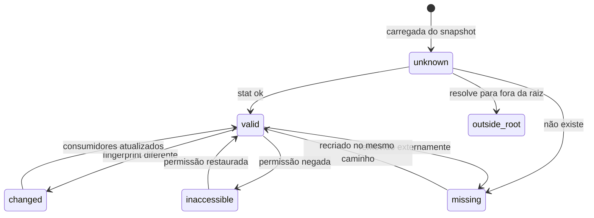

# 7. Project Runtime (arquivos, processos, permissões e sincronização)

> Parte da documentação por funcionalidade do Open Semantic. Índice em [README.md](README.md). Contratos em [`contratos/schemas/project.schema.json`](../../contracts/schemas/project.schema.json).

## O que é

O único componente que toca o projeto real: lê e escreve arquivos, lista diretórios, executa processos e observa mudanças externas. Tudo passa por **raízes autorizadas** com **capacidades separadas** (ler, escrever, excluir, executar). É a fonte de verdade sobre arquivos e processos (V0.1 §4.1 regra 1).

Decisão D1 (confirmada por Arthur em 12/10): **no MVP, o projeto é um diretório local.** `Project.location` é uma união (`local` | `remote`) e `ArtifactReference` usa `rootId + caminho relativo`, nunca caminho absoluto, para que um projeto remoto entre depois sem mudar nenhum contrato acima desta camada.

## Responsabilidades

- Resolver caminhos relativos dentro das raízes; recusar qualquer coisa fora (`PATH_OUTSIDE_ROOT`), inclusive via link simbólico.
- Criar e manter `ArtifactReference`s: id estável por recurso, mesmo após renomear (quando o rename é observado).
- Calcular fingerprints (mtime, tamanho, hash de conteúdo) e revalidar referências.
- Observar o sistema de arquivos e publicar `artifact.changed` / `artifact.missing`.
- Executar comandos segundo a política da raiz e transmitir saída e código de saída.
- Escrever com pré-condição de fingerprint (base da detecção de conflito do Editor).

## O que não faz

- Não decide se o agente pode agir; aplica a política e devolve `confirmation_required` quando a política manda.
- Não interpreta conteúdo (isso é do agente ou de indexadores que alimentam o Open Semantic).
- Nunca envia o caminho absoluto do disco para o agente.

## Modelo de dados

| Objeto | Campos-chave |
|---|---|
| `Project` | `location` (`local` com `rootPath` absoluto, visível só aqui), `roots[]`, `rootRef` |
| `AuthorizedRoot` | `id`, `path` relativo, `capabilities`, `commandPolicy` |
| `ArtifactReference` | `id`, `kind` (`directory`/`file`/`process`), `locator` (`rootId`+`path` ou `processKey`), `validity`, `provenance` |
| `Fingerprint` | `mtime`, `size`, `contentHash` (`sha256:…`) |
| `ArtifactValidity.status` | `unknown`, `valid`, `changed`, `missing`, `inaccessible`, `outside_root` |

Caminhos relativos são validados no schema (`ProjectRelativePath`: sem `/` inicial, sem letra de drive, sem `..`, sem barra invertida). O runtime revalida após resolver links simbólicos.

## Operações

| Operação | Argumentos | Saída | Idempotente | Capacidade | Confirmação (agente) |
|---|---|---|---|---|---|
| `project.resolve` | `rootId`, `path` | `ArtifactReference` (cria se preciso) | Sim | read | Não |
| `project.stat` | `artifactId` | validade + fingerprint | Sim | read | Não |
| `project.list_dir` | `artifactId`, `depth≤3`, `exclude?` | entradas com `artifactId` | Sim | read | Não |
| `project.read_file` | `artifactId`, `range?`, `maxBytes` | conteúdo + fingerprint | Sim | read | Não |
| `project.create_dir` | `rootId`, `path`, `parents=true` | artefatos criados ou existentes | Sim | write | Não |
| `project.write_file` | `artifactId` ou `rootId`+`path`, `content`, pré-condição `artifact_unchanged` | novo fingerprint | Sim (mesmo conteúdo) | write | Sim |
| `project.move` | `artifactId`, `toPath` | mesmo `artifactId`, novo locator | Sim | write | Sim |
| `project.delete` | `artifactId` | — | Sim | delete | Sim, risco alto |
| `project.create_file` | `rootId`, `path`, `content` | `artifactId` + fingerprint (recusa se existe) | Não | write | Sim |
| `project.run_command` | `rootId`, `command`, `cwd?`, `timeoutMs?` | `exitCode`, `timedOut`, fim da saída | **Não** | execute (ou `confirm_all`) | `commandPolicy` |
| `project.kill_process` | `artifactId` | — | Sim | execute | Não |
| `project.revalidate` | `artifactIds?` (todos se vazio) | mudanças de validade | Sim | read | Não |

### Política de comandos

`commandPolicy.mode`:
- `confirm_all` (padrão): todo comando do agente pede confirmação mostrando o comando exato e o diretório.
- `allowlist_then_confirm`: comandos na lista (comparação exata da linha de comando) rodam direto; o resto pede confirmação.
- `deny_all`: a raiz não executa nada.

O usuário digitando no Terminal executa como usuário (sem confirmação); a política vale para pedidos do agente. Saída é transmitida como `process.output` e o fim como `process.exited` com código.

## Sincronização e consistência

Tradução das seis regras da V0.1 §4.1:

| Regra | Mecanismo |
|---|---|
| Fonte de verdade explícita | Arquivos/processos: aqui. Posições: Workspace. Conhecimento: Open Semantic. Nenhum outro módulo guarda cópia de conteúdo como verdade. |
| Atualização observável | Observador de sistema de arquivos → `artifact.changed`/`missing` → Mods recarregam/degradam, Open Semantic marca `stale`. |
| Referências verificáveis | Ao abrir o workspace e antes de qualquer uso, `validity.status` precisa ser `valid`; senão a operação é `REFERENCE_INVALID`. |
| Conflitos explícitos | Escrita com `artifact_unchanged`; fingerprint diferente → `EXTERNAL_CHANGE_CONFLICT`, nunca sobrescreve. |
| Atualização eventual controlada | Status `pending`/`stale` no Open Semantic enquanto a reanálise não termina. |
| Operações rastreáveis | Toda escrita, exclusão e execução gera `ActionRecord`. |

Estados de uma referência:

Renomear fora do ambiente aparece como `missing` + um arquivo novo. Para não perder vínculos, o runtime tenta casar pelo `contentHash` dentro de uma janela curta e, se casar, mantém o `artifactId` com novo `locator`. Se não casar, o vínculo antigo fica `missing` e o usuário/agente pode religar.

## Eventos

Publica: `artifact.created`, `artifact.changed`, `artifact.missing`, `artifact.validity_changed`, `process.output`, `process.exited`.
Consome: nenhum de outros módulos (é a base da pilha).

## Segurança (V0.1 §6)

- Raízes e capacidades são configuradas pelo usuário; o agente não pode ampliá-las.
- Validação de caminho no runtime, após resolver links, não no modelo de IA.
- Erros reais; nunca simular sucesso.
- Exclusões vão para a lixeira do sistema quando possível (`undo.kind: "snapshot"`); quando não, o cartão de confirmação diz “irreversível”.
- Variáveis de ambiente e segredos não entram em `argumentsRedacted` do histórico.

## Critérios de aceitação

Da V0.1: A4, B1, B2, C4, E5. Mais:

- `project.resolve` com `../` ou caminho absoluto é rejeitado com `PATH_OUTSIDE_ROOT`.
- Link simbólico dentro da raiz apontando para fora é rejeitado.
- Arquivo alterado externamente gera `artifact.changed` e o Editor aberto sobre ele entra em conflito se estiver modificado.
- Comando fora da allowlist com `allowlist_then_confirm` não executa antes da confirmação.

## Como começar

1. Implementação falsa em memória (árvore de arquivos simulada) com a mesma interface; ela destrava Explorer e Editor no incremento 1 sem tocar o disco.
2. Implementação local real: resolução segura de caminhos, `list_dir`, `read_file`, `stat`, fingerprints.
3. Observador de mudanças e revalidação ao abrir.
4. Escrita com pré-condição, depois `run_command` com política (incremento 4).

## Questões abertas

- D1 (local vs. remoto) — ver [README](README.md#decisões).
- Projetos grandes: limites de profundidade e exclusões padrão (`.git`, `node_modules`) já previstos; indexação incremental fica para depois.
