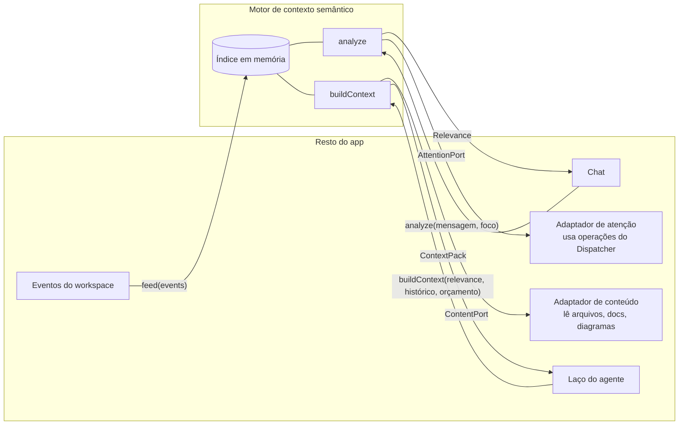
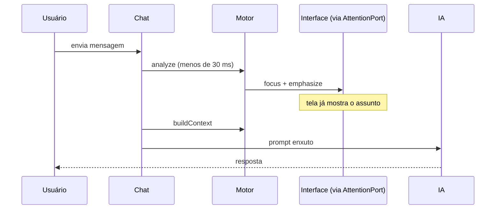

# 8. Motor de contexto semântico

> Parte da documentação por funcionalidade do Open Semantic. Índice em [README.md](README.md). Usa o grafo do [05 Open Semantic](05-open-semantic.md) e serve ao laço do agente do [06](06-conversa-agente-e-protocolo.md). Pedido do Arthur, 12/10. Esta versão substitui as anteriores.

## Em uma frase

Um componente próprio que, a cada mensagem do usuário, descobre em milissegundos **do que ela fala** no workspace, pede à interface para focar e destacar isso, e depois monta para a IA **só o contexto necessário**.

## Requisitos, em ordem de importância

1. **Desacoplado.** Componente próprio, sem depender de canvas, diagramas, tela ou provedor de IA. Conversa com o resto do app só por interfaces de entrada e saída bem definidas.
2. **Rápido.** Busca determinística e local, antes de qualquer chamada à IA. Foco e destaque aparecem na tela antes da resposta começar.
3. **Preciso.** Acha o assunto principal mesmo em textos longos. Pergunta ao usuário só quando a dúvida muda para onde o foco vai.
4. **Contexto enxuto para a IA.** Com o mesmo resultado, monta um prompt pequeno, dentro de um orçamento de tokens, com histórico curto e cache.

O documento segue essa ordem.

---

## 1. Desacoplamento: o componente e suas interfaces

O motor é o pacote `packages/semantic-context`. Ele não importa nenhum outro pacote do app, e o CI checa isso. Tudo o que ele sabe do mundo entra por uma interface, e tudo o que ele faz sai por outra.



### Entradas (o app chama o motor)

```ts
interface SemanticContextEngine {
  /** Mantém o índice atualizado. Recebe os eventos que os módulos já publicam. */
  feed(events: WorkspaceEvent[]): void;

  /** O que a mensagem quer dizer no workspace. Puro, determinístico, sem IA. */
  analyze(input: { text: string; focus: VisualFocus; recent: RecentTopics }): Relevance;

  /** Prompt enxuto para a IA a partir do resultado de analyze. */
  buildContext(input: { relevance: Relevance; history: ChatMessage[]; budget: TokenBudget }): Promise<ContextPack>;
}
```

### Saídas (o motor chama o app, por interfaces que o app implementa)

```ts
/** Como o motor pede reações visuais. Não sabe o que é câmera, nó ou canvas. */
interface AttentionPort {
  focus(target: TargetRef, reason: string): void;
  emphasize(items: { ref: TargetRef; level: "primary" | "secondary" }[]): void;
  clear(): void;
  ask(question: string, options: { ref: TargetRef; label: string }[]): Promise<TargetRef | undefined>;
}

/** Como o motor obtém conteúdo quando precisa (só em buildContext). */
interface ContentPort {
  read(ref: TargetRef, level: DetailLevel): Promise<string>;  // trecho de arquivo, seção de doc, recorte de diagrama
}
```

`TargetRef` é só um id estável do workspace (`nd_`, `dgm_`, `sem_`, `rgn_`, `art_`, opcionalmente com intervalo). O motor nunca recebe objetos da interface.

### Os adaptadores ficam fora do motor

- **Adaptador de atenção:** traduz `AttentionPort` em operações do Dispatcher, assinadas pelo ator `system:context`. `focus` → `navigation.frame` (já existe). `emphasize`/`clear` → `view.emphasize`/`view.clear_emphasis` (novas, visuais, não persistidas). `ask` → `conversation.clarify` (nova; a resposta volta como evento). A regra de câmera do [04](04-semantic-navigator.md) continua valendo: se o usuário está mexendo na tela, o foco vira sugestão.
- **Adaptador de conteúdo:** traduz `ContentPort` em `project.read_file` com intervalo, leitura de seção de documento e recorte de diagrama.
- **Feed de eventos:** repassa `diagram.*`, `semantic.*`, `region.*` e `artifact.changed` ao `feed`.

Resultado: dá para trocar a interface, ligar um cliente MCP externo ou testar o motor sem Electron, só com um workspace de exemplo e uma mensagem.

---

## 2. Rapidez: busca local antes da IA

A cada mensagem enviada, em sequência:



Como fica rápido:

- **Índice invertido em memória**, construído ao abrir o workspace e atualizado por eventos (só o item que mudou). Cobre rótulos de nós e arestas de todos os tipos de diagrama, entidades semânticas (nome, aliases, descrição, papel), títulos de regiões, diagramas e seções de documentos, e caminhos de arquivos.
- **Busca BM25**, da família do TF-IDF e mais precisa para textos curtos como rótulos, com peso por campo (id e alias exatos acima de nome, nome acima de descrição).
- **Grafo de vizinhança pré-calculado** (quem se liga a quem, em que diagramas cada entidade aparece), para não andar no grafo inteiro a cada mensagem.
- **Nada de rede, nada de IA** em `analyze`. Roda fora da thread da interface.

Metas, num workspace de 30 projetos com cerca de 50 mil itens indexados:

| Etapa | Meta |
|---|---|
| `analyze` de mensagem curta | menos de 30 ms |
| `analyze` de texto com 2 mil palavras | menos de 80 ms |
| Do envio até a ênfase na tela | menos de 100 ms |
| Atualizar o índice após um lote | menos de 20 ms por item |

Opcional: enquanto o usuário digita (150 ms após a última tecla), acender candidatos de leve, sem mover a câmera.

---

## 3. Precisão: o assunto principal e as dúvidas

`analyze` devolve:

```ts
interface Relevance {
  topics: { refs: TargetRef[]; salience: number }[];  // topics[0] é o assunto principal
  primaryTarget?: TargetRef;                           // o lugar com mais detalhe sobre ele
  assumptions: { term: string; chosen: TargetRef; alternatives: TargetRef[] }[];
  question?: { text: string; options: TargetRef[] };   // só quando a dúvida muda o foco
}
```

### Como acha o assunto principal

1. **Normaliza** o texto: minúsculas, sem acento, plural simples e sinônimos do domínio ("back-end", "backend", "servidor", "API" → papel `backend`; "front", "web", "tela" → papel `frontend`). Aliases das entidades entram nos sinônimos sozinhos.
2. **Quebra em frases** e busca cada uma no índice.
3. **Pesa as frases.** Perguntas e pedidos valem mais que contexto. A última pergunta vale mais. Marcadores como "o ponto aqui é", "principalmente", "especificamente" multiplicam o peso.
4. **Agrupa em tópicos** pelo grafo: o que está ligado (mesmo diagrama, relação direta, mesma região) vira um tópico. A saliência do tópico é a soma das frases que o citam. O maior é o assunto principal.
5. **Escolhe o ponto principal**: entre os diagramas com elementos do assunto principal, o que tem mais deles juntos e o tipo mais detalhado. Para "como é a interação entre back e front", um diagrama de sequência com os dois vence o de componentes que só mostra a aresta.

Exemplo de texto longo: *"Revisei o checkout e o cadastro, estão ok. Mas o ponto aqui é que o pagamento está lento; acho que a chamada do serviço de pagamentos ao antifraude é síncrona. Como isso está desenhado hoje?"* Assunto principal: pagamentos → antifraude (marcador e pergunta final). Checkout e cadastro ficam como tópico secundário, com ênfase leve. Nenhuma pergunta ao usuário.

### Quando supor e quando perguntar

Um termo com mais de um candidato (dois back-ends, por exemplo) é resolvido nesta ordem:

1. o usuário clicou ou citou (`@nome`);
2. o assunto estava na conversa recente ou na tela;
3. o grafo restringe (só um back-end se liga ao front já identificado);
4. o primeiro candidato está bem à frente do segundo na busca.

Se nada resolve **e** o termo está no assunto principal, o motor pergunta (`AttentionPort.ask`), com os candidatos como botões e destacados no canvas. Clicar num deles no canvas também responde. A escolha vira conversa recente e não é perguntada de novo.

Se resolveu por suposição, a interface mostra uma linha discreta ("Entendi como **api-pedidos** ↔ **app-web**. Trocar"). Dúvidas fora do assunto principal nunca geram pergunta.

### Como medimos

Cada "Trocar" e cada resposta a uma pergunta vira um caso de teste (texto → assunto certo). Metas iniciais: assunto principal certo em pelo menos 90% das mensagens do conjunto de teste, curtas e longas, e pergunta em no máximo 1 de cada 5 mensagens.

---

## 4. Contexto enxuto para a IA

Só depois do foco na tela, o laço do agente chama `buildContext`. O motor reaproveita o `Relevance` em vez de recomeçar.

### O que entra

1. **Núcleo:** os itens do assunto principal, expandidos um ou dois saltos no grafo (o caminho entre front e back: cliente HTTP, endpoint, handler).
2. **Cada item num nível de detalhe**, escolhido para caber no orçamento:

| Nível | Conteúdo | Custo típico |
|---|---|---|
| Referência | id, tipo, nome | ~10 tokens |
| Resumo | descrição, interfaces, ligações | 50 a 200 |
| Trecho | recorte do diagrama, seção do doc, intervalo do arquivo | 200 a 2 mil |
| Completo | arquivo ou documento inteiro | o que tiver |

3. **Mapa do workspace:** todos os projetos só como referência (30 projetos ≈ 400 tokens). A IA sabe que existem e pode pedir mais.
4. **Conhecimento rejeitado ou inválido** nunca entra como fato.

O conteúdo vem pelo `ContentPort`, em texto compacto (não JSON verboso). Se faltar algo, a IA tem ferramentas para buscar: consulta semântica, vizinhança de uma entidade e leitura de arquivo por intervalo.

### Orçamento

- **Alvo de 40 mil tokens** por chamada e **teto de 80 mil**, abaixo dos 100 mil onde o Haiku cobra 5 vezes mais.
- O teto é checado **antes de cada chamada do laço**, não só no início do pedido. Se for passar, resultados antigos de ferramentas viram referência e o nível de detalhe desce.
- A contagem é estimada localmente e calibrada pelo uso real que o provedor devolve.

### Histórico curto

- Os últimos 3 pedidos vão literais, mas sem o contexto e as leituras de arquivo que tiveram (viram referência).
- O resto vira um resumo curto: objetivo, decisões, o que foi feito, pendências.
- Decisões tomadas na conversa são gravadas como entidades `decision` no Open Semantic. Voltam ao contexto pela busca quando o assunto volta, sem ocupar o histórico.

### Cache

O prompt vai do mais estável ao mais volátil: instruções e ferramentas, mapa do workspace, resumo, pedidos recentes, contexto do pedido, voltas do laço. Há pontos de cache entre essas camadas, e o mapa é gerado sempre igual, byte a byte, enquanto nada muda. Fora do provedor, o motor guarda por hash de conteúdo as contagens de tokens, as seções de docs e os resumos de arquivos, e descarta quando chega `artifact.changed`.

---

## Ponto de partida no código (M2, PR #4)

Lido em `origin/m2-conversa`. O que o motor resolve:

- `summarizeWorkspace` manda o workspace inteiro em toda mensagem, com todos os diagramas e até 200 entidades, cortadas por ordem de criação. Estimativa: 30 projetos passam de 80 mil tokens só nisso.
- Essa cópia fica acumulada no histórico até a compactação.
- A compactação só é avaliada no início do pedido, então uma chamada no meio do laço pode passar de 100 mil.
- Há um único ponto de cache, no fim.

Encaixe: `conversation.ts` deixa de chamar `summarizeWorkspace` e `compactHistory` e passa a chamar `buildContext` antes de cada chamada ao modelo. O resto do laço (tetos, ferramentas, lotes) não muda.

## Critérios de aceitação

1. **Desacoplado:** `packages/semantic-context` não importa nenhum pacote do app (checado no CI); os testes do motor rodam sem Electron, com adaptadores falsos.
2. **Rápido:** com 30 projetos sintéticos, `analyze` leva menos de 30 ms e a ênfase aparece na tela em menos de 100 ms, sem chamar a IA.
3. **Texto longo:** num texto com marcador de ênfase e pergunta final, o assunto principal é o da pergunta; tópicos de contexto ficam secundários e não geram pergunta.
4. **Dúvida:** com dois back-ends ligados ao front e nada recente, aparece a pergunta; com um só, ele é suposto e aparece "Trocar".
5. **Ponto principal:** havendo diagrama de sequência e de componentes com os mesmos elementos, o foco vai para o de sequência.
6. **Contexto:** no workspace de 30 projetos, a pergunta sobre a integração back e front gera um contexto de menos de 16 mil tokens, com os outros 28 projetos só como referência.
7. **Teto:** nenhuma chamada de um pedido de 12 voltas passa de 80 mil tokens.
8. **Determinismo:** mesmo estado e mesma mensagem dão o mesmo resultado, byte a byte.

## Onde entra no plano

- **M2.5, logo depois do PR #4:** o pacote com as interfaces, índice BM25, `analyze` com assunto principal e pergunta rápida, adaptadores de atenção e de conteúdo, as operações `view.emphasize`, `view.clear_emphasis` e `conversation.clarify`, e `buildContext` com orçamento, histórico curto e cache. Funciona com os diagramas e entidades que já existem. Critérios 1 a 5, 7 e 8.
- **M3:** perfil de cada projeto (front, back, o que expõe e consome) e relações entre repositórios, o que melhora a resolução de papéis e a expansão no grafo. Ferramentas semânticas para a IA. Decisões gravadas como entidades. Critério 6.
- **M4:** invalidação de cache ligada ao observador de arquivos e ajuste de pesos com os casos de teste coletados.

## Questões abertas

- BPMN ainda não é um tipo em `diagram.schema.json` e precisa entrar para ser indexado.
- O alvo de 40 mil tokens precisa ser revisto com uso real.
- Busca por embeddings ajudaria com sinônimos que o dicionário não cobre. Fica de fora por enquanto, para manter tudo local, rápido e explicável.
