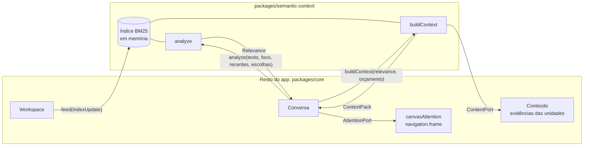
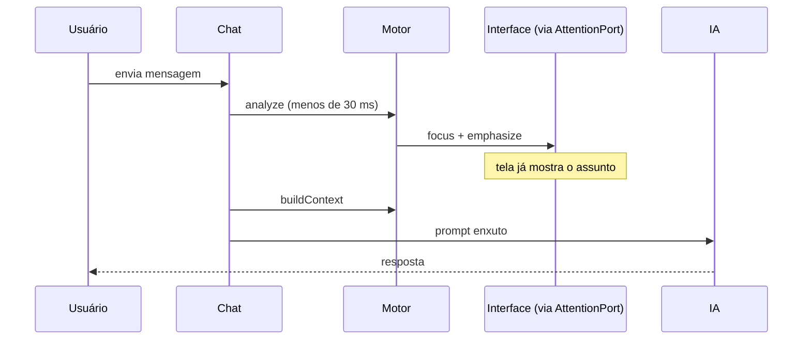

# 8. Motor de contexto semântico

> Parte da documentação por funcionalidade do Open Semantic. Índice em [README.md](README.md). Usa o grafo do [05 Open Semantic](05-open-semantic.md), as unidades de contexto do [09](09-ancoragem-e-projecao.md) e serve ao laço do agente do [06](06-conversa-agente-e-protocolo.md). Pedido do Arthur, 12/10. Implementado no M2.5; as seções dizem o que já está no código e o que fica para depois.

## Em uma frase

Um componente próprio que, a cada mensagem do usuário, descobre em milissegundos **do que ela fala** no workspace, pede à interface para focar e destacar isso, e depois monta para a IA **só o contexto necessário**.

## Requisitos, em ordem de importância

1. **Desacoplado.** Componente próprio, sem depender de canvas, diagramas, tela ou provedor de IA. Conversa com o resto do app só por interfaces de entrada e saída bem definidas.
2. **Rápido.** Busca determinística e local, antes de qualquer chamada à IA. Foco e destaque aparecem na tela antes da resposta começar.
3. **Preciso.** Acha o assunto principal mesmo em textos longos. Pergunta ao usuário só quando a dúvida muda para onde o foco vai.
4. **Contexto enxuto para a IA.** Com o mesmo resultado, monta um prompt pequeno, dentro de um orçamento de tokens, com histórico curto e cache.

O documento segue essa ordem.

---

## 1. Desacoplamento: o componente e suas interfaces

O motor é o pacote `packages/semantic-context`. Ele não importa nenhum outro pacote do app, e o CI checa isso. Tudo o que ele sabe do mundo entra por uma interface, e tudo o que ele faz sai por outra.



### Entradas (o app chama o motor)

```ts
class SemanticContextEngine {
  /** Mantém o índice em dia. O app manda o estado dos itens; o que não mudou é ignorado. */
  feed(update: IndexUpdate): void;   // { upsert?: IndexDoc[]; remove?: TargetRef[]; links?: UnitLink[] }

  /** Do que a mensagem fala, em unidades de contexto. Puro, determinístico, sem IA. */
  analyze(input: { text: string; focus?: VisualFocus; recent?: TargetRef[]; choices?: Record<string, TargetRef> }): Relevance;

  /** Texto compacto para a IA, dentro do orçamento, a partir do resultado de analyze. */
  buildContext(input: { relevance: Relevance; budget?: TokenBudget; content?: ContentPort }): Promise<ContextPack>;

  /** Busca simples, usada pela ferramenta search_workspace da IA. */
  search(text: string, limit?: number): SearchResult[];
}
```

`IndexDoc` é o que pode ser achado: uma unidade (entidade semântica, inclusive o repositório), um diagrama, um nó, uma aresta, um mod ou uma região, sempre com as unidades a que pertence (`unitIds`). `UnitLink` liga unidades: `contains` (pai e filho, como no canvas do 09) e as relações semânticas. O motor não recebe o snapshot nem conhece o protocolo.

### Saídas (o motor chama o app, por interfaces que o app implementa)

```ts
/** Como o motor pede reações visuais. Não sabe o que é câmera, nó ou canvas. */
interface AttentionPort {
  focus(target: TargetRef, emphasis: { ref: TargetRef; level: "primary" | "secondary" }[], reason: string): void | Promise<void>;
  ask(question: Clarification): Promise<TargetRef | undefined>;
}

/** Como o motor obtém conteúdo que não está no índice (só em buildContext). */
interface ContentPort {
  read(ref: TargetRef, level: DetailLevel): Promise<string | undefined>;
}
```

`TargetRef` é só um id estável do workspace (`sem_`, `dgm_`, `nd_`, `edg_`, `mod_`, `rgn_`). O motor nunca recebe objetos da interface.

### Os adaptadores ficam fora do motor (`packages/core/src/context.ts`)

- **Índice:** `workspaceIndex(snapshot)` traduz o workspace em `IndexUpdate`. A unidade leva nome, aliases, descrição, tipo e papel (`attributes.role`, ou o que o tipo sugere: serviço e API contam como back-end). Diagramas e mods ficam nas unidades em que estão ancorados (ou no repositório); nós ficam na unidade que representam. A conversa sincroniza antes de cada pedido; o custo é só o que mudou.
- **Atenção:** `canvasAttention` traduz `focus` em `navigation.frame`, assinado pelo agente, com o ponto principal e os elementos de ênfase primária destacados. A regra de câmera do [04](04-semantic-navigator.md) continua valendo: se o usuário está mexendo na tela, o foco vira sugestão. Se o assunto já está na tela, a câmera fica e só o destaque muda. Uma unidade sem nada desenhado não move a câmera. `ask` vira um cartão no chat (entrada `choice`) e o pedido espera a escolha ou o Parar.
- **Conteúdo:** descrição e resumos das evidências atuais de cada unidade; nas suposições, o motivo registrado.

Resultado: dá para trocar a interface, ligar um cliente MCP externo ou testar o motor sem Electron. Os testes do motor rodam só com o pacote.

---

## 2. Rapidez: busca local antes da IA

A cada mensagem enviada, em sequência:



Como fica rápido:

- **Índice invertido em memória**, atualizado por item (o que não mudou não é reindexado). Cobre unidades (nome, aliases, descrição, tipo, papel), diagramas, rótulos de nós e arestas, mods e regiões. Seções de documentos e caminhos de arquivos entram no M3.
- **Busca BM25**, da família do TF-IDF e mais precisa para textos curtos como rótulos, com peso por campo (nome e alias 3, id da unidade 1,5, tipo e papel 1, descrição 0,7). Sinônimos do mesmo termo não somam: vale o melhor.
- **Termos comuns podados:** um termo achado em milhares de itens só percorre os 300 em que pesa mais, além dos já achados por termos raros. O resultado é o mesmo na avaliação e o texto longo ficou 2 vezes mais rápido.
- **Grafo de vizinhança pré-calculado** (pai de cada unidade, unidades ligadas, em que diagramas cada unidade aparece), refeito só quando o índice muda.
- **Nada de rede, nada de IA** em `analyze`.

Metas e medição atual, num workspace sintético de 30 repositórios com cerca de 48 mil itens indexados:

| Etapa | Meta | Hoje |
|---|---|---|
| `analyze` de mensagem curta (p95) | menos de 30 ms | cerca de 2 ms |
| `analyze` de texto com 2 mil palavras (mediana) | menos de 80 ms | 45 a 55 ms |
| Indexar o workspace inteiro | | cerca de 400 ms |
| Do envio até a ênfase na tela | menos de 100 ms | a medir no app |

Opcional: enquanto o usuário digita (150 ms após a última tecla), acender candidatos de leve, sem mover a câmera.

---

## 3. Precisão: o assunto principal e as dúvidas

`analyze` devolve:

```ts
interface Relevance {
  /** Assuntos como unidades de contexto (doc 09). topics[0] é o assunto principal. */
  topics: { unitId: TargetRef; unitIds: TargetRef[]; refs: TargetRef[]; salience: number }[];
  primaryTarget?: TargetRef;   // o lugar com mais detalhe sobre o assunto principal
  emphasis: { ref: TargetRef; level: "primary" | "secondary" }[];
  assumptions: { term: string; said: string; chosen: TargetRef; alternatives: TargetRef[]; why: "selection" | "recent" | "graph" | "margin" }[];
  question?: { term: string; text: string; options: { ref: TargetRef; label: string }[] };
  timings: { analyzeMs: number };
}
```

O motor responde com unidades, não com elementos soltos: um nó achado conta pela unidade que representa, e o assunto é o conjunto de unidades. Os elementos achados (`refs`) servem para escolher o diagrama e o que destacar.

### Como acha o assunto principal

1. **Normaliza** o texto: minúsculas, sem acento, plural simples e sinônimos do domínio ("back-end", "backend", "servidor", "API" → papel `backend`; "front", "web", "tela" → papel `frontend`). Aliases das entidades entram nos sinônimos sozinhos.
2. **Quebra em frases** e busca cada uma no índice.
3. **Pesa as frases.** Perguntas e pedidos valem mais que contexto. A última pergunta vale mais. Marcadores como "o ponto aqui é", "principalmente", "especificamente" multiplicam o peso.
4. **Generaliza:** um termo que acha uma unidade e as peças dentro dela fala da unidade ("estoque" é o repositório, não cada módulo dele).
5. **Agrupa em tópicos:** a mesma unidade é sempre o mesmo tópico; itens citados na mesma frase se juntam quando estão no mesmo diagrama, em unidades ligadas ou uma dentro da outra. O que já foi identificado pelo nome entra primeiro, para um verbo comum ("consome") não empurrar as peças nomeadas para fora. A saliência é a soma das frases que citam o tópico; o maior é o assunto principal.
6. **Escolhe o ponto principal**: entre os diagramas com elementos do assunto, o que cobre mais unidades dele e o tipo mais detalhado (sequência acima de fluxo e BPMN, acima de arquitetura). Quando a mensagem fala de interação ("conversa", "chama", "integra"), o diagrama de sequência ganha mais peso. Um assunto que é um repositório inteiro enquadra a unidade dele, que mostra tudo o que está ancorado ali, a menos que a mensagem cite um diagrama dele pelo título.

Exemplo de texto longo: *"Revisei o checkout e o cadastro, estão ok. Mas o ponto aqui é que o pagamento está lento; acho que a chamada do serviço de pagamentos ao antifraude é síncrona. Como isso está desenhado hoje?"* Assunto principal: pagamentos → antifraude (marcador e pergunta final). Checkout e cadastro ficam como tópico secundário, com ênfase leve. Nenhuma pergunta ao usuário.

### Quando supor e quando perguntar

Um termo com mais de um candidato (dois back-ends, por exemplo) é resolvido nesta ordem:

1. a resposta a uma pergunta rápida deste pedido;
2. o usuário selecionou ou citou (`@nome`, ou o id);
3. outro termo da mensagem já identificou a unidade (um diagrama citado pelo título identifica as unidades em que está ancorado);
4. o grafo, na mesma frase: só um back-end está dentro do que foi citado ou ligado a ele ("o back-end do app mobile");
5. a conversa recente, depois o que está na tela;
6. o grafo, no resto da mensagem, e o que está ligado aos assuntos recentes;
7. o primeiro candidato está bem à frente do segundo na busca (1,4 vez ou mais).

Se nada resolve **e** o termo está no assunto principal, o motor pergunta: um cartão no chat com os candidatos como botões, e o pedido só vai para a IA com a resposta. A resposta vale para aquele pedido e vira assunto recente; não vira regra fixa, porque "o back-end" do portal não é o do app mobile.

Se resolveu por suposição, o chat mostra uma linha discreta ("Supus que back-end é api-contas. Trocar"). Trocar põe a escolha como assunto mais recente e leva o foco para ela; os próximos pedidos partem dela. Dúvidas fora do assunto principal nunca geram pergunta.

### Como medimos: a avaliação roda no CI

`packages/semantic-context/test/avaliacao/casos.json` tem mensagens com o resultado que uma pessoa esperaria: unidades que precisam (ou não podem) estar no assunto principal, onde o foco deve ir, se deve perguntar e com quais opções, e o que deve supor. Elas rodam contra um workspace sintético de 30 repositórios (dois sistemas escritos à mão, loja e banco digital, e 28 gerados como ruído), com cerca de 48 mil itens. O teste falha se:

- a precisão (casos sem nenhum erro) ficar abaixo de 90%;
- o motor perguntar em mais de 1 de cada 5 mensagens;
- a latência passar das metas da seção 2 (runners de CI ganham o dobro de folga).

Hoje: 27 casos, 100% de acerto. Seis deles foram escritos depois do ajuste, sem olhar o resultado, e cinco passaram de primeira. Cada "Trocar" e cada resposta a pergunta que mostrar um erro deve virar um caso novo.

---

## 4. Contexto enxuto para a IA

Só depois do foco na tela, a conversa chama `buildContext`. O motor reaproveita o `Relevance` em vez de recomeçar. O bloco `<workspace>` de cada pedido passa a ser um cabeçalho pequeno (projeto ativo, pastas e raízes dos projetos, controle da câmera) seguido do texto do motor: assunto principal, também citado e mapa do workspace. O `get_workspace` completo continua disponível como ferramenta, e a nova `search_workspace` busca no índice.

### O que entra

1. **Núcleo:** os itens do assunto principal, expandidos um ou dois saltos no grafo (o caminho entre front e back: cliente HTTP, endpoint, handler).
2. **Cada item num nível de detalhe**, escolhido para caber no orçamento:

| Nível | Conteúdo | Custo típico |
|---|---|---|
| Referência | id, tipo, nome | ~10 tokens |
| Resumo | descrição, interfaces, ligações | 50 a 200 |
| Trecho | recorte do diagrama, seção do doc, intervalo do arquivo | 200 a 2 mil |
| Completo | arquivo ou documento inteiro | o que tiver |

3. **Mapa do workspace:** todos os projetos só como referência (30 projetos ≈ 400 tokens). A IA sabe que existem e pode pedir mais.
4. **Conhecimento rejeitado ou inválido** nunca entra como fato.

O conteúdo vem pelo `ContentPort`, em texto compacto (não JSON verboso). Se faltar algo, a IA tem ferramentas para buscar: consulta semântica, vizinhança de uma entidade e leitura de arquivo por intervalo.

### Orçamento

- **Alvo de 40 mil tokens** por chamada e **teto de 80 mil**, abaixo dos 100 mil onde o Haiku cobra 5 vezes mais.
- No M2.5 a compactação do histórico passa a disparar acima de 40 mil tokens por chamada (era 80 mil).
- Depois: checar o teto **antes de cada chamada do laço**, não só no início do pedido; se for passar, resultados antigos de ferramentas viram referência e o nível de detalhe desce.
- A contagem é estimada localmente (`estimate`) e pode ser calibrada pelo uso real que o provedor devolve (`observe`).

### Histórico curto (depois do M2.5)

- Os últimos 3 pedidos vão literais, mas sem o contexto e as leituras de arquivo que tiveram (viram referência).
- O resto vira um resumo curto: objetivo, decisões, o que foi feito, pendências.
- Decisões tomadas na conversa são gravadas como entidades `decision` no Open Semantic. Voltam ao contexto pela busca quando o assunto volta, sem ocupar o histórico.

### Cache (depois do M2.5)

O prompt vai do mais estável ao mais volátil: instruções e ferramentas, mapa do workspace, resumo, pedidos recentes, contexto do pedido, voltas do laço. Há pontos de cache entre essas camadas, e o mapa é gerado sempre igual, byte a byte, enquanto nada muda. Fora do provedor, o motor guarda por hash de conteúdo as contagens de tokens, as seções de docs e os resumos de arquivos, e descarta quando chega `artifact.changed`.

---

## O que mudou no código (M2.5)

- `packages/semantic-context`: o motor, sem dependências. Índice BM25, `analyze`, `buildContext`, `search`, e a avaliação.
- `packages/core/src/context.ts`: os adaptadores (índice, conteúdo, atenção).
- `conversation.ts`: antes do modelo, analisa a mensagem, pergunta se precisar, leva o foco e monta o `<workspace>` com o contexto do motor no lugar de `summarizeWorkspace`. Guarda as unidades dos últimos assuntos. Nova ferramenta `search_workspace`. Entradas `choice` no chat (pergunta e suposição) e `Conversation.choose`.
- `navigation.frame` do agente atualiza o destaque mesmo quando o alvo já está na tela.
- Painel do agente: cartão da pergunta rápida e "Trocar" na suposição.

## Critérios de aceitação

1. **Desacoplado:** `packages/semantic-context` não importa nenhum pacote do app (checado no CI); os testes do motor rodam sem Electron, com adaptadores falsos.
2. **Rápido:** com 30 projetos sintéticos, `analyze` leva menos de 30 ms e a ênfase aparece na tela em menos de 100 ms, sem chamar a IA.
3. **Texto longo:** num texto com marcador de ênfase e pergunta final, o assunto principal é o da pergunta; tópicos de contexto ficam secundários e não geram pergunta.
4. **Dúvida:** com dois back-ends ligados ao front e nada recente, aparece a pergunta; com um só, ele é suposto e aparece "Trocar".
5. **Ponto principal:** havendo diagrama de sequência e de componentes com os mesmos elementos, o foco vai para o de sequência.
6. **Contexto:** no workspace de 30 projetos, a pergunta sobre a integração back e front gera um contexto de menos de 16 mil tokens, com os outros 28 projetos só como referência.
7. **Teto:** nenhuma chamada de um pedido de 12 voltas passa de 80 mil tokens.
8. **Determinismo:** mesmo estado e mesma mensagem dão o mesmo resultado, byte a byte.
9. **Avaliação:** o conjunto de mensagens de avaliação roda no CI com pelo menos 90% de acerto, no máximo 1 pergunta a cada 5 mensagens e as latências da seção 2.

## Onde entra no plano

- **M2.5 (feito):** o pacote com as interfaces, índice BM25, `analyze` com assunto principal em unidades de contexto e pergunta rápida, adaptadores de atenção e de conteúdo, `buildContext` com orçamento e a avaliação no CI. Critérios 1 a 5 e 8; o 6 está coberto no workspace sintético.
- **Logo depois:** ênfase secundária visível no canvas (um campo novo no `Focus` da navegação), teto checado a cada volta do laço (critério 7), histórico curto e pontos de cache.
- **M3:** perfil de cada projeto (front, back, o que expõe e consome) e relações entre repositórios, o que melhora a resolução de papéis e a expansão no grafo. Ferramentas semânticas para a IA. Decisões gravadas como entidades. Critério 6.
- **M4:** invalidação de cache ligada ao observador de arquivos e ajuste de pesos com os casos de teste coletados.

## Ancoragem (doc 09)

Desde o [09](09-ancoragem-e-projecao.md), todo diagrama tem `anchorIds`, as unidades de contexto de que ele fala, e cada repositório tem a sua unidade. O motor usa isso de três formas: os assuntos são unidades; um diagrama pertence às unidades em que está ancorado (ou ao repositório), e um nó à unidade que representa; e o foco numa unidade vira `navigation.frame` com `semanticEntityIds`, que enquadra tudo o que está ancorado nela e dentro dela.

## Questões abertas

- BPMN ainda não é um tipo em `diagram.schema.json` e precisa entrar para ser indexado.
- O alvo de 40 mil tokens precisa ser revisto com uso real.
- Busca por significado (embeddings) fica para depois, e só como reserva: local, rodando quando a BM25 não acha nada ou acha pouco, para sinônimos que o dicionário não cobre. A BM25 continua sendo o caminho principal por ser rápida, determinística e explicável.
- O dicionário de sinônimos e a lista de palavras de interação estão em português e inglês; outros idiomas precisam de listas próprias.
