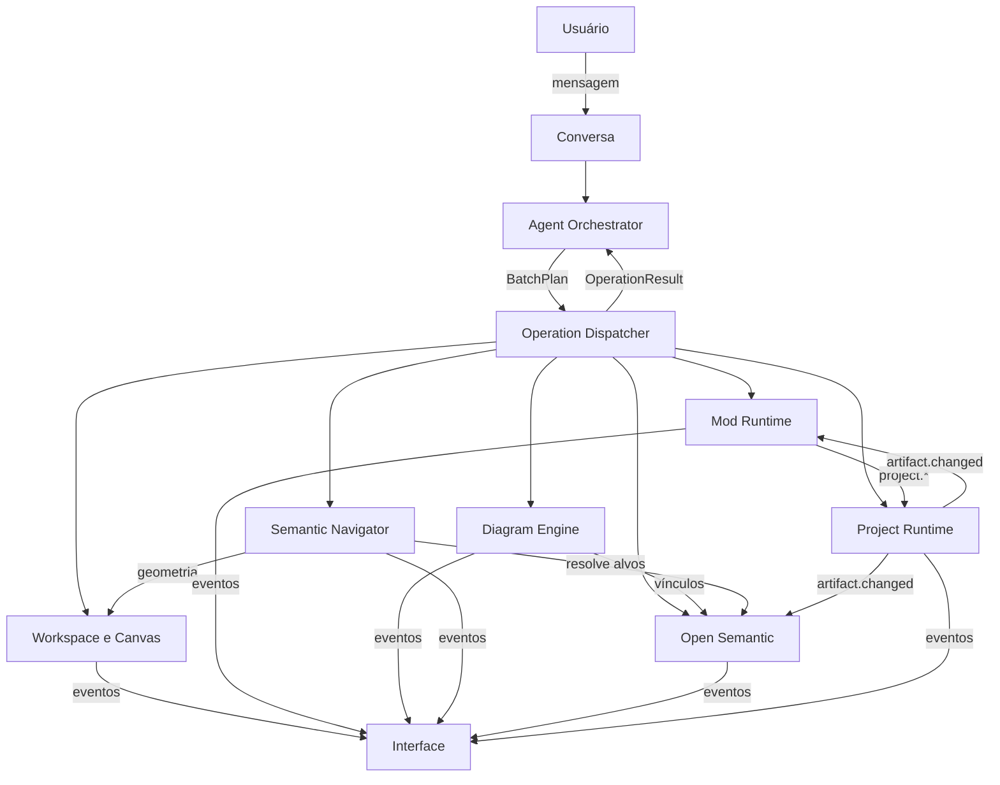

# Open Semantic — documentação por funcionalidade

Esta pasta separa a especificação em uma página por funcionalidade principal. Cada página traz o que a funcionalidade faz e não faz, seu modelo de dados, operações, máquinas de estado, eventos, critérios de aceitação e como começar a implementá-la. Juntas, elas formam o conteúdo que a V0.1 pedia para a **Especificação Técnica V0.2** (contratos formais, máquina de estados, interfaces entre módulos e fluxo de referência).

Documentos de origem: [visão do produto](../visao.md) e [Especificação V0.1](../especificacao-v0.1.md). Guia de implementação: [como-comecar.md](../como-comecar.md).

## Funcionalidades

| # | Funcionalidade | Módulo lógico (V0.1 §1) | Fonte de verdade de… |
|---|---|---|---|
| 1 | [Workspace e Canvas](01-workspace-e-canvas.md) | Workspace Store | posições, regiões, preferências |
| 2 | [Mods e Mod Runtime](02-mods.md) | Mod Runtime | instâncias de mods e sua configuração |
| 3 | [Diagram Engine](03-diagram-engine.md) | Diagram Engine | modelos de diagrama e layout |
| 4 | [Semantic Navigator](04-semantic-navigator.md) | Semantic Navigator | câmera, foco, controle agente/usuário |
| 5 | [Open Semantic](05-open-semantic.md) | Open Semantic | entidades, relações, evidências |
| 6 | [Conversa, agente e protocolo](06-conversa-agente-e-protocolo.md) | Interface conversacional, Agent Orchestrator | operações, lotes, histórico |
| 7 | [Project Runtime](07-project-runtime.md) | Project Runtime | arquivos, diretórios, processos |
| 8 | [Motor de contexto semântico](08-gestao-de-contexto.md) | Agent Orchestrator (contexto) | índice de relevância, contexto enviado à IA |
| 9 | [Ancoragem e projeção do canvas](09-ancoragem-e-projecao.md) | Open Semantic + Workspace Store | a que unidade de contexto cada diagrama pertence; o layout sai daí |
| 10 | [Resposta visual](10-resposta-visual.md) | Agente + Diagram Engine | explicação de estrutura ou fluxo vira diagrama com legenda; o texto acompanha |

## Como as peças se ligam

Regras que valem para todas as páginas:

- **O agente só age por operações** registradas no Dispatcher. Nenhum módulo lê o estado interno de outro; usam operações ou eventos.
- **Toda referência é por id estável** com prefixo (`ws_`, `prj_`, `mod_`, `dgm_`, `nd_`, `edg_`, `sem_`, `rel_`, `evd_`, `art_`, `rgn_`, `act_`, `bat_`…), definido em [`common.schema.json`](../../contracts/schemas/common.schema.json).
- **Persistido vs. não persistido** é explícito em cada schema.
- **Erros estruturados** com um código de uma lista fechada (`ErrorCode`).
- **Conhecimento tem qualidade**: `verified`, `inferred`, `pending`, `stale`, `invalid`, `rejected`.

## Contratos formais

Em [`../../contracts/`](../../contracts/):

| Arquivo | Conteúdo |
|---|---|
| `schemas/common.schema.json` | ids, geometria, atores, procedência, estados de conhecimento, erros |
| `schemas/project.schema.json` | projeto, raízes autorizadas, `ArtifactReference`, fingerprints |
| `schemas/semantic.schema.json` | entidades, relações, evidências e a regra “inferência não é fato” |
| `schemas/mod.schema.json` | tipos de mod, capacidades, instâncias, configs dos 4 tipos, estado de runtime |
| `schemas/diagram.schema.json` | diagrama, nós, arestas, layout separado, patches |
| `schemas/navigation.schema.json` | câmera, foco, histórico, controle, `FrameRequest` |
| `schemas/workspace.schema.json` | snapshot persistido completo, canvas e regiões |
| `schemas/operation.schema.json` | requisição, resultado, pré-condições, lotes, `ActionRecord`, eventos |
| `exemplos/*.json` | fluxo de referência (plano, resultado, estado final) e uma rejeição |
| `validar.py` | valida schemas e exemplos, integridade referencial, DAG do lote e testes negativos |

Para rodar: `python3 contracts/validar.py` (precisa de `pip install jsonschema`). Estado atual: tudo válido.

## Decisões

As três decisões abertas da V0.1 foram confirmadas por Arthur em 12/10. Os contratos foram desenhados para que uma mudança futura afete só o módulo indicado.

| # | Decisão | Padrão adotado | Se mudar, afeta |
|---|---|---|---|
| D1 | Persistência do projeto | **Confirmado (12/10):** diretório local no MVP; `location` já aceita `remote` | Só o Project Runtime |
| D2 | Estrutura semântica | **Confirmado (12/10):** camada lógica atrás de `SemanticStore`, armazenamento plugável | Só a implementação do Open Semantic |
| D3 | Modelo de interação | **Confirmado (12/10):** lotes com dependências explícitas (DAG), validação prévia e confirmação única | Agent Orchestrator e Dispatcher |

Também ficou confirmado que o produto é um **aplicativo desktop em Electron** (12/10).

Escolhas novas desta documentação que também valem uma revisão:

- Agente pode criar diretórios sem confirmação, mas escrever conteúdo, mover, excluir e executar comandos pede confirmação (configurável por raiz).
- Navegação automática espera 4 s depois de o usuário mexer na câmera e, nesse intervalo, vira sugestão clicável.
- `CanvasObject` usa o mesmo id do mod/diagrama (uma posição por objeto).

## Glossário

- **Mod:** componente funcional no canvas (Explorer, Editor, Terminal, Tabela).
- **Região:** área nomeada do canvas, opcionalmente ligada a entidades semânticas.
- **Artefato / ArtifactReference:** identidade estável de um arquivo, diretório ou processo real.
- **Evidência:** observação imutável que sustenta conhecimento verificado.
- **Lote (BatchPlan):** plano de operações com dependências, enviado de uma vez pelo agente.
- **Fingerprint:** mtime + tamanho + hash, usado para detectar mudanças externas.
